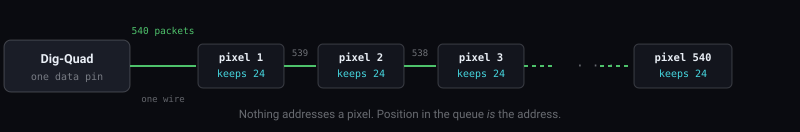
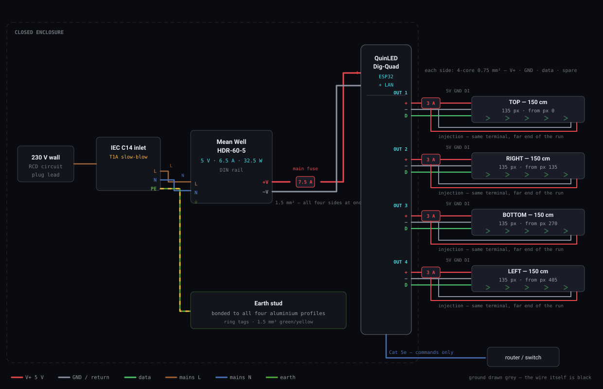
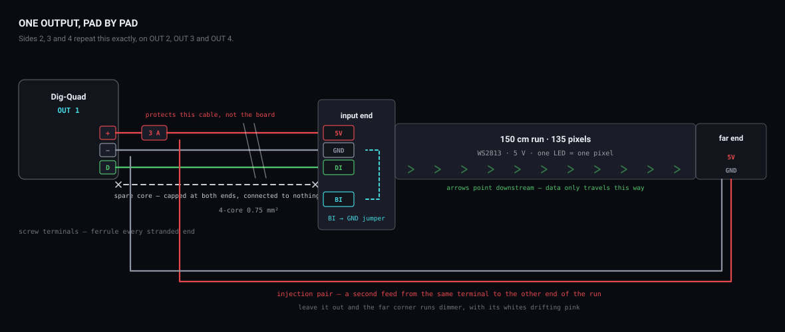

*L.I.F.E. · Phase 1 · Build manual*

# Getting the frame to light up

One frame, 150 × 150 cm, in two builds. Everything from which strip to buy to which conductor goes where, why each one is there, and what you will see when it is wrong. Build A is the 5 V strip already in your profiles; Build B is the 24 V RGBW frame it becomes.

## Part I · Decide

### 00 · The two builds, and which one this manual is written in

Same frame, same carcass, same controller, same wiring, same software. Only the strip and the supply differ — which is why the prototype is worth building at all.

**Build A · what you are building now — 5 V WS2813, already in your profiles**

- Pixels: 540 · 135 a side
- Supply: Mean Well HDR-60-5
- Brightness limiter: ON · 5000 mA
- Costs you: nothing further in LEDs

**Build B · the frame it becomes — 24 V FCOB WS2814 RGBW**

- Pixels: 84 · 21 a side
- Supply: Mean Well LRS-200-24
- Brightness limiter: OFF
- Costs you: two 5 m reels and a supply

> **Where each one lives.** Build B is decided in § 01, and its figures sit beside Build A’s in § 09 (WLED settings), § 11 (power budget) and § 12 (bill of materials). Everything else — the wire register, both diagrams, the build steps and the fault table — is written in **Build A’s numbers**, because that is the frame in front of you. What changes when you move to B is the strip, the supply and those three sections; nothing else in this manual.

### 01 · Settle the strip first

This is **Build B**’s strip — the frame you end up with. Build A, the prototype in section 02, is already decided by what you own. Everything downstream — pixel count, power supply, fuse, wire gauge — falls out of it. Both options below are the same family (WS2814 four-in-one RGBW in a COB/FCOB package), so both give the continuous line of light with no visible dots. They differ in how finely you can address it and how much current runs through the frame. Figures are for a **6 m perimeter**, four sides of 150 cm.

**Recommended — 24 V FCOB WS2814 RGBW**

- Addressable pitch: 71 mm
- Pixels per side: 21
- Pixels total: 84
- Draw: 20 W/m → 120 W
- Current at full: 5.0 A
- Per side: 1.25 A

**Alternative — 12 V FCOB WS2814 RGBW**

- Addressable pitch: 62 mm
- Pixels per side: 24
- Pixels total: 96
- Draw: 18 W/m → 108 W
- Current at full: 9.0 A
- Per side: 2.25 A

Take the **24 V**. You gain almost nothing from 12 V's 9 mm finer pitch, and you pay for it with nearly double the current — thicker wire, more voltage drop over 1.5 m, more heat in every terminal. The one number worth bracing for: **84 pixels, not hundreds**. COB strips run their LEDs in series groups to reach the supply voltage, so one addressable pixel is a 7 cm chunk. The light is continuous; the *control* over it is chunky. At 150 cm that is still 21 steps of gradient per side and a spark the size of a fist — fine — but it is a quarter of what the controller mock-up assumes, so set that number honestly in WLED and in the app.

Confirm the cut pitch on the exact reel you order; it varies between products in the same family. You need **two 5 m reels** — one reel yields three 150 cm runs and you need four.

> **Two numbers on the product page, and only one of them is the pixel count.** A reel advertised at *784 LEDs/m* is telling you its LED density — that is the number that buys the seamless neon line, and anything from about 576/m up will look continuous. The pixel count is the other number: 14 addressable segments per metre, **21 per side**. Type 784 into WLED and nothing will work.

> **Watch the IC name when ordering.** WS2811 and SM16704 are three-channel RGB controllers — a strip built on them cannot do white, whatever the listing title says. RGBW at 12 V or 24 V is **WS2814**; SK6812 is the 5 V equivalent. Ask for the white channel's colour temperature too: **2700–3000 K warm white** is the flattering choice for skin, which is the whole point of a frame people stand inside.

### 02 · Build A — the frame at full size, now

The frame is 150 cm; that is the premise, not a variable. **You have the strip and it is already mounted in profile** — four runs, ready to wire — so Build A costs nothing further in LEDs. You have a full-size, full-working frame this week, on a supply you already own, at six times the pixel density of the final build. Everything except the strip and the supply carries straight over to Build B: the carcass, the controller, the wiring, the enclosure, the software. The profiles carry over too *if* their inner width takes a 10 mm COB — measure the channel before you assume it. That one measurement is the difference between swapping a strip and remounting all four sides.

| Build A         | Figure          | Note                                                                                                                          |
|-----------------|-----------------|-------------------------------------------------------------------------------------------------------------------------------|
| Frame size      | 150 × 150 cm    | as designed — a person fits inside it                                                                                         |
| Strip           | owned           | already cut and mounted in aluminium profile, four runs — no top-up needed — this was the other long-lead item and it is gone |
| Pixels          | 540             | 135 a side, 1.1 cm pitch — against 21 a side on the 24 V COB                                                                  |
| Supply          | HDR-60-5        | **owned** · 5 V · 6.5 A · 32.5 W, DIN rail, covered terminals                                                                 |
| Full-white draw | 32.4 A          | 540 × 60 mA — five times what the supply gives                                                                                |
| Usable ceiling  | ≈20 % white     | saturated colours run much brighter; it is only white that is capped                                                          |
| Wiring          | 4 × 1.5 m       | one run per side, each fed from its own output                                                                                |
| Injection       | if the ends dim | 1.5 m at 5 V is borderline — feed the far end of a run too if you see it fall off                                             |

> **Turn the brightness limiter ON for this one.** The opposite of the advice for Build B, and for a good reason: ABL's maths is built around 5 V strips, so here it is correct. Set the maximum current to **5000 mA**, as 4 × 1250 mA per output (§ 08, step 09), and WLED caps brightness itself instead of browning out. Why 5000 and not 6000: 6000 mA is 92 % of the supply's 6.5 A, held continuously, in a closed box, with the ESP32 drawing from the same 5 V rail. 5000 mA leaves the supply at about 77 % and cool enough to run all evening.

> **Count the LEDs before you set anything.** The listing says both "90 LEDs/m" and "100 pixels/m", which cannot both be true — on WS2813 one LED is one pixel. Count the LEDs in 10 cm and multiply up; that number, not the advert, is what goes into WLED. You are not buying any more of this strip: the four runs are already cut and in the profiles.

> **See Build B's resolution before you buy its strip.** Once Build A is lit (§ 08), open each of the four segments in WLED and set **Grouping** to **6**. Six of your 1.1 cm pixels then move as one 6.7 cm block — 22½ blocks a side, as close to Build B's 21 blocks of 7.1 cm as 135 allows. Run the sweep, the comet and the sparkle and look at the frame from where people will stand. If the steps in the gradient and the size of a spark are acceptable, the 84-pixel frame will be too; if not, you have found out for the price of a setting instead of two reels. Set Grouping back to 1 afterwards.

Two things this build will not do. It will not photograph people warmly — WS2813 is RGB, so its white is mixed from three colours and reads thin and slightly green on skin. And at 32 W against Build B's 120 W it is a moody, dark-room light rather than a bright one, which suits the reference shots but not a lit space. Resist buying a bigger 5 V supply to fix that: it is 30 A of supply for a strip you are going to replace. Put the money toward the COB instead and live with the cap.

If you would rather not spend anything on a strip you will retire, the alternative is to cut a metre off for the bench, prove the software on that, and build the frame once in RGBW. You lose the full-size playground; you save the top-up.

### 03 · Seven corrections to the v1.0 plan

What changed between the plan you wrote and the one in this manual, and why. The full reasoning for each now lives further down; the arrows say where.

#### 01 · COB will not go round a corner — so don't make it

Four separate 150 cm strips, one per side, each on its own Dig-Quad output. No data crosses a corner, only power — and each side becomes a natural WLED segment, which is how the app already thinks about the frame. This is what decides Dig-Uno against Dig-Quad: take the **Quad**.  
→ § 06 — the arrow, and the four corners

#### 02 · One supply, not four

The v1.0 plan had a Mean Well per side. Use one — and the reason is not cost, it is ground. Four supplies means four different ideas of what zero volts is, and you would have to bond them together anyway before the data is valid.  
→ § 06 — what “ground” really means

#### 03 · Power up in the opposite order

Your Step 2 starts by connecting the supply to 230 V. Make that the **last** action, not the first. Wire the DC side completely, check polarity at every terminal, then energise.  
→ § 08 — step 07

#### 04 · The two supplies are built differently — treat them differently

**Build B — the LRS is an open-frame supply.** Mean Well LRS units have exposed 230 V screw terminals and an earth (FG) terminal by design; they are meant to be built into an enclosure, with that earth terminal connected. **Build A — the HDR-60-5 is not.** It is a class II DIN-rail supply: covered terminals and no earth terminal at all, so nothing in the box is earthed through it. What both builds share, in a piece the public stands inside: closed box, strain-relieved IEC inlet, **aluminium profiles bonded to earth**, RCD-protected circuit. Worth an electrician's look before it is ever shown publicly.  
→ § 06 — the earth conductor

#### 05 · WLED's brightness limiter is right for one build and wrong for the other

**On** at 5000 mA for Build A, where the supply is deliberately smaller than worst case. **Off** for Build B, where the same arithmetic is meaningless and the supply covers the real worst case instead.  
→ § 08 — step 09

#### 06 · The Pi does not gate the light coming on

Steps 1 to 3 of your plan produce a fully working, app-controlled light frame with no Pi involved at all — WLED does the lot. The Pi earns its place in Phase 2, when a camera or a microphone has to drive the lighting. It also cannot replace the controller, which is the question worth answering before someone asks it.  
→ § 04 — why this rules out the Raspberry Pi

#### 07 · Point the light at the person, not the wall

Your note says face the LEDs inward or at the wall. Those are different pieces. Facing the wall gives the halo; only **inward** lights whoever is standing in the frame, which is the entire effect the reference shots are built on. Inward is the primary run. If you want the halo too, that is a second strip facing back — a Phase 1.5 addition, and the Dig-Quad has a spare output for it.

## Part II · Understand

### 04 · The one idea everything else hangs on

Before any cable makes sense, this does. It is the difference between wiring by instruction and wiring by understanding.

Your strip is not a light. It is **540 small computers in a row**, each with a red, a green and a blue LED and a chip that can only do one thing: listen.

The controller sends one long burst down a single wire: 24 bits for pixel 1, then 24 for pixel 2, and so on, 540 times. Each chip swallows the first 24 bits it hears, sets its own three LEDs to that brightness, and passes everything remaining to its neighbour. There is no addressing, no reply, no acknowledgement. **A pixel's position in the chain is its only identity.**

- **The strip is one-way.** That is what the little arrows printed on it mean. Feed data into the wrong end and pixel 540 is listening at a door nobody is knocking on.
- **A dead chip kills everything after it.** Not because the power stopped — because the message stopped. If side two goes dark from the ninetieth LED onward, you are looking for one failed chip, not a wiring fault.
- **The count has to be exact.** Tell WLED 540 when there are 500 and the last 40 packets fall off the end of the strip into nothing. Tell it 500 when there are 540 and the last forty pixels never get told anything and sit dark.
- **Timing is not negotiable.** A zero and a one are the same 1.25 µs pulse with a different shape — about 400 nanoseconds of difference. There is no clock wire to keep both ends in step, so the strip trusts the controller's stopwatch absolutely.

> **Go deeper — why this rules out the Raspberry Pi**
>
> 400 nanoseconds is roughly the time light takes to cross a room. To hold that, a chip has to do nothing else at all in that instant.
>
> The ESP32 on your Dig-Quad has dedicated hardware for exactly this — it clocks the pulses out of a peripheral while the processor gets on with other things. It cannot be interrupted, because the processor isn't doing the work.
>
> A Raspberry Pi runs Linux, which is designed to be *fair*, not *punctual*. It will happily pause your program for half a millisecond to deal with the network card. Half a millisecond is four hundred pixels of garbage.
>
> Hence the split: **the controller makes light, the Pi makes decisions.** In Phase 2 the Pi will look at a camera and say "warmer, brighter, from the left" — and the ESP32 will translate that into 12,960 precisely-shaped pulses.

**540 — Pixels** · 135 a side, at 90 LEDs per metre. Count them in 10 cm to be sure.

**≈ 4 ms — Per frame** · 135 pixels × 24 bits at 1.25 µs on each output. The four outputs send at the same time, so the longest run sets the time, not all 540 pixels in a row. That would allow over 200 frames a second; WLED's own refresh rate (42 a second by default) is the real limit, not the wire.

**32 A — If unlimited** · What 540 RGB pixels would draw at full white, if nothing stopped them.

**6.5 A — What you have** · The HDR-60-5's ceiling. Five times less. This is why the limiter is not optional.

### 05 · The four objects on your bench

Each one does exactly one job. Knowing which job makes the wiring obvious rather than memorised.

#### Mean Well HDR-60-5 — energy

Turns 230 V alternating mains into **5 V steady direct current**, up to 6.5 A. Nothing else in the box touches mains voltage.

> **Go deeper — what a supply actually does**
>
> Mains voltage swings from +325 V to −325 V and back, fifty times a second. LEDs and logic chips cannot use that; they need a voltage that sits still.
>
> The HDR chops the mains into pulses at tens of kilohertz, runs them through a small transformer, rectifies the result and smooths it. What comes out the low-voltage end is 5 V that **holds steady no matter what you connect** — right up until you ask for more than 6.5 A, at which point it protects itself by sagging or shutting down.
>
> That last sentence is the whole reason for the brightness limiter. The supply will not explode if you overload it; it will simply stop being 5 V, and everything downstream misbehaves at once.

#### QuinLED Dig-Quad — translation

An ESP32 running WLED, plus four independently fused outputs. It turns **an instruction from your phone into precisely-timed pulses** — and lifts those pulses from the ESP32's 3.3 V up to the 5 V the strip expects.

> **Go deeper — the level shifter, and why the board exists at all**
>
> An ESP32 speaks at 3.3 V. A WS2813 running on 5 V decides something is a "1" only above roughly 3.5 V. So a bare ESP32 sits just under the threshold — it works on a short bench wire on a cool day, and fails on a warm evening with a metre of cable.
>
> The Dig-Quad carries a **level shifter**: a chip that reads the weak 3.3 V signal and re-transmits it as a clean, full-strength 5 V one. That is most of what you are paying for. The rest is the fuse holders, the screw terminals, and someone else having designed the ground layout properly.
>
> You took the LAN version. Good call — the ESP32's aerial is about to be surrounded by four aluminium profiles, which is very nearly a Faraday cage.

#### Four 150 cm WS2813 runs — light

Already cut and seated in your profiles. Each run needs **three connections at its input end** — 5 V, ground, data — and, at 5 V over a metre and a half, **two more at the far end**.

> **Go deeper — why WS2813 has a spare data pad**
>
> WS2813 is the dual-signal version of the familiar WS2812. Alongside the normal data input `DI` there is a backup input `BI`, wired so each pixel also hears from the pixel *two* places upstream.
>
> The point is failure tolerance: if one chip dies, the next one still receives the message on its backup line and the run keeps working. On a plain WS2812 a single dead chip blacks out everything after it.
>
> Pixel one has nothing upstream, so its `BI` has no source. Leaving it floating usually works. Tying it to the `GND` pad beside it gives it a defined level and removes one suspect the day the first pixel misbehaves — thirty seconds with the iron while it is already hot.

#### Raspberry Pi — not yet

It is **not in this circuit**. It has its own USB supply and touches the frame only over the network. You can finish and show Phase 1 without ever unboxing it.

### 06 · Every wire, and what it does

This is the register. Swatches are the real jacket colours, so you can match them against what is in your hand. Read it once before you strip anything.

#### Inside the enclosure — mains side

*230 V*

##### Live — brown · 1.0 mm²

`IEC C14 inlet → HDR-60-5 · L`

The one that is dangerous. It carries the 230 V push from the wall into the supply. **The fuse in the IEC inlet sits in this line**, so a fault opens the live conductor first.

##### Neutral — blue · 1.0 mm²

`IEC C14 inlet → HDR-60-5 · N`

The return path. Current that goes in the brown comes back out the blue — **exactly as much, always**. That equality is what an RCD watches for.

##### Earth — green/yellow · 1.5 mm²

Build A: `IEC earth pin → its own gland → all four aluminium profiles`  
Build B: `IEC earth pin → enclosure stud → LRS · FG and all four aluminium profiles`

This wire does nothing. Every day, for years, it carries no current at all. It exists for **the one second when a live conductor touches metal** — then it gives that fault a path so easy that hundreds of amps flow instantly and the RCD trips, instead of the current finding its way through whoever is leaning on the frame.

**How it runs differs per build.** The HDR-60-5 of Build A is class II — double-insulated, no earth terminal — so the earth has nothing to land on inside the box. It goes straight from the inlet's earth pin out through its own cable gland to the profiles: a ring tag on each of the four, linked side to side, because anodising does not conduct and a corner joint is no earth path. Build B's LRS is class I, so its FG terminal needs earth too: there the wire lands on a stud in the enclosure first, with one lead to the LRS and one out to the profiles.

> **Go deeper — why the profiles specifically**
>
> Your frame is a rectangle of exposed aluminium that people are invited to stand inside and touch, and it shares a box with 230 V — behind covers on Build A's HDR, on open screw terminals on Build B's LRS, but in the same box either way. If a strand of live ever works loose and lands on the chassis, the aluminium becomes live and nothing tells you.
>
> Bonded to earth, the same accident becomes a dead short. The RCD sees the imbalance between brown and blue — current leaving that isn't coming back — and disconnects in under 40 milliseconds.
>
> **Ring tags, not a wire jammed under a screw.** This connection has to survive years of transport and vibration, because you will never notice if it fails.

#### Supply to controller — the main feed

*carries all four sides*

##### V+ main feed — red · 1.5 mm²

`HDR · +V → 7.5 A ATO fuse → Dig-Quad · +`

Every amp the whole frame draws passes down this one wire — up to 6.5 A. That is why it is the thickest conductor on the board, and why it is the only one with its own fuse.

> **Go deeper — the fuse protects the cable, not the board**
>
> This is the single most misunderstood component in any DC build, so it is worth being precise: **a fuse protects the wire downstream of it.** It is not there to save the Dig-Quad.
>
> Think about what a short circuit is. If the red and black touch somewhere between the supply and the board, the only thing limiting the current is the resistance of the cable itself — which is nearly nothing. The supply pushes as hard as it can into that. The cable is now a heating element, inside a closed box, and nothing is on fire yet only because the supply gave up first.
>
> The 7.5 A rating comes from the cable: 1.5 mm² safely carries well over that, so the fuse blows long before the insulation gets warm. It is sized **above** your working current (6.5 A) and **below** what the cable can survive. That is the entire calculation.
>
> Semiconductors, by the way, cannot be protected by fuses at all. They fail in microseconds; a fuse takes milliseconds. The fuse is for the copper and the box.

##### Ground return — black · 1.5 mm²

`HDR · −V → Dig-Quad · −`

The way back. Current is a loop — nothing "gets used up" in the LEDs. Every amp that leaves down the red returns up this black. It also does a second job that nothing else can: **it is the reference against which every data pulse is measured**.

> **Go deeper — what "ground" really means, and why it is the answer to half of all LED faults**
>
> "5 volts" is not a property of a wire. It is a *difference* between two points. Saying the red wire is at 5 V is meaningless until you say what it is 5 V above — and that thing is ground.
>
> Now apply that to the data line. When the Dig-Quad sends a "1", it raises the data wire to 5 V. But the pixel at the far end doesn't measure 5 V against the controller's ground — it measures against **its own** ground, whatever that happens to be sitting at.
>
> If both ends share a thick, short ground wire, those are the same thing and the pixel reads exactly what was sent. If the ground is thin, long, corroded, or — worst of all — missing because two separate power supplies each have their own, the pixel is measuring the signal against a different zero. A "1" can arrive looking like a "0". You get flicker, wrong colours, random pixels, or nothing at all, and none of it looks like a ground fault.
>
> **This is why one supply beats four.** Not cost. Four supplies means four different ideas of what zero is, and you would have to bond them all together anyway to make the data valid — arriving right back where one supply already put you, having bought three extra mains connections for the privilege.
>
> When an addressable strip misbehaves and the wiring "looks fine", suspect the ground first, second and third.

#### Controller to each side

*4-core, × 4*

##### V+ — red · 0.75 mm²

`Dig-Quad output · + → 3 A ATO fuse → strip 5 V pad`

Feeds one side, at most 1.25 A once the limiter is doing its work. The 3 A fuse protects **this thinner cable**, which is why it is a smaller number than the main feed — thinner wire, lower fuse.

##### GND — black · 0.75 mm²

`Dig-Quad output · − → strip GND pad`

Return path *and* signal reference, in the same wire. Never run a data line to a strip without its ground beside it — the data becomes meaningless without it, even if the strip lights up from power it found elsewhere.

##### DATA — green · 0.75 mm²

`Dig-Quad output · D → strip DI pad · arrow pointing away`

The whole picture, one side of it, many times a second — 42 at WLED's default refresh rate. **No current worth mentioning flows here** — it is a voltage that wiggles. This wire could be hair-thin and work perfectly; it is 0.75 mm² only because it came in the same jacket as the others.

> **Go deeper — the arrow, and the four corners**
>
> Look for the small arrows printed along the strip. They point **downstream** — the direction the message travels. Your data wire lands at the pad the arrows point *away* from. Get it backwards and the strip does nothing at all; there is no error, no half-working, just dark.
>
> This one-way flow is also the reason each side gets its own output. If you ran one continuous data line round all four sides, every corner would need a soldered joint carrying a 1.25-microsecond pulse — and a corner joint is exactly what gets knocked loose in transport. One broken corner and everything past it goes black.
>
> Four outputs means **no data ever crosses a corner**. Only power does, and power does not care about being interrupted for a microsecond.

##### Spare core — white · 0.75 mm²

`terminate at both ends · connect to nothing`

Deliberately unused. You are pulling cable through a frame you are about to close up, and the day you want a backup data line, a temperature sensor or a second strip facing outward, **this is the difference between an afternoon and a rebuild**. Cap it, label it, forget it.

#### Power injection — the far ends

*2-core, × 4*

##### V+ and GND, second feed — red + black · 0.75 mm²

`same output terminal → the far end of that side's strip`

Runs alongside the strip and feeds it from the other end as well. **No data** — power only. At 24 V you could skip this. At 5 V over 150 cm you cannot.

> **Go deeper — why 5 V sags where 24 V doesn't**
>
> The copper tracks printed along a flexible strip are thin — much thinner than the wire feeding them. Push a couple of amps down 150 cm of that and you lose perhaps a third of a volt by the far end.
>
> A third of a volt out of 24 V is one percent. Nobody sees it. A third of a volt out of 5 V is **six percent**, and you absolutely see it — the far corner of the frame is visibly dimmer than the near one.
>
> Worse, it doesn't dim evenly. Blue LEDs need the most voltage to light (around 3.2 V, against red's 2.0 V), so blue starves first. **Your whites drift pink and orange toward the far end** while the reds stay fine. On a piece whose entire purpose is flattering light on a person's face, that is not a detail you can live with.
>
> Feeding both ends halves the distance any current has to travel through the strip, and the sag largely disappears. Run these cables *now*, while the frame is open.

#### Network

*no light travels here*

##### Ethernet — Cat 5e

`Dig-Quad LAN port → router or switch`

Carries **instructions only** — "side two, warm white, 70 percent". A few bytes, occasionally. Unplug it mid-show and the frame carries on doing exactly what it was last told, indefinitely. That is worth knowing: **the network is not a lifeline, it is a remote control.**

> **Go deeper — why you chose cable over Wi-Fi**
>
> The ESP32's aerial is about to be mounted inside a square of aluminium profile. Metal reflects radio; a frame like that is close enough to a shielded box to make Wi-Fi unreliable in exactly the unpredictable way that ruins an exhibition.
>
> Cable removes the whole category of problem — and removes it in a venue you have never visited, on a network you do not control, on the one evening it matters.
>
> Set a fixed address for it in the router (a **DHCP reservation**) while you are at it. An installation whose address moves is an installation that breaks on show day, always in front of people.

### 07 · The whole thing, drawn

Every conductor from the wall socket to the last pixel, on one sheet. Tap either drawing to open it full-screen and zoom in.

Build A, complete. Mains enters left and stops at the supply — nothing right of the HDR-60-5 is above 5 V. Each of the four outputs is separately fused and carries its own power, ground and data; no data ever crosses a corner of the frame.

One output at pad level. The spare core, the backup-input jumper and the injection pair are the three things easy to leave out and awkward to add later.

## Part III · Build

### 08 · The build, in order

The sequence is chosen so that every irreversible action happens after the thing that would have warned you about it. Do not reorder it, particularly the last three.

1.  #### Flash WLED with nothing else connected

    **Do:** plug the Dig-Quad into your computer by USB, open install.wled.me in Chrome or Edge, and install the **ESP32 Ethernet** build — it reports itself as `ESP32_Ethernet`; the plain ESP32 build has no Ethernet driver, and the cable would do nothing. No supply, no strip, nothing in the terminals.

    You are proving the board arrived alive while there is nothing attached that could be damaged and nothing attached that could confuse the diagnosis. If this step fails, you know with certainty it is the board or the cable — and that is worth a great deal later, when something fails and you need one thing you can trust.

2.  #### Count the LEDs and settle the number

    **Do:** measure 10 cm of strip and count the LEDs in it. Multiply up. At 90 per metre you should find 135 in a 150 cm run, and 540 across four.

    Every later setting depends on this one figure, and product listings routinely contradict themselves about it. On WS2813 one LED is one pixel, so counting is definitive in a way that reading the advert is not. Write the number on a piece of tape and stick it to the bench.

    > **Watch:** a listing quoting both "90 LEDs/m" and "100 pixels/m" cannot be right about both. Your eyes settle it in thirty seconds.

3.  #### Get tails onto the input end of each run

    **Do:** solder red, black and green to the 5V, GND and DI pads at the end the arrows point away from. Heatshrink every joint. While the iron is hot, bridge pixel one's BI pad to the GND beside it.

    Those pads are copper foil glued to plastic. They lift if you pull them, and a lifted pad means cutting the first pixel off and starting again a centimetre further along. The heatshrink is strain relief, not insulation.

    > **Your strip is already in the profile,** which is not what the ideal order assumes — soldering into a mounted channel is genuinely unpleasant. Ease the last 30 mm out of the channel, work on it flat on the bench, and press it back afterwards. If a run will not come free without damage, solderless clip-on connectors are a legitimate answer for a prototype; just meter them, because they are the least reliable joint in the build.

4.  #### Meter every tail before it ever sees power

    **Do:** multimeter on continuity. Touch red to black on each tail. It should *not* beep. Then check red really does reach the 5 V pad and black really does reach GND.

    Two wires on one small pad and a blob of solder is precisely where a stray strand bridges the rails. If that bridge exists, the moment you apply power the supply sees a dead short — and the Dig-Quad is what pays for it. Ten seconds per tail, four tails.

5.  #### Light one run on the bench

    **Do:** one strip, one output, supply connected, everything loose on the bench. Get it lighting. Send pure red from WLED and see what actually comes out.

    You are testing four separate assumptions at once — that the reel is good, that your soldering is sound, that the pixel count is right, and that the colour order is what you think. Finding any of them wrong now costs minutes. Finding it after the frame is closed up costs an afternoon.

    > **Expect this:** if the first pixel shows nonsense while everything after it is fine, that is the 3.3 V threshold problem, not a broken strip — pixel one is cleaning the signal up for the rest. The Dig-Quad has a level shifter on board and should prevent it. If you see it anyway, check your board revision against the official QuinLED pinout before you suspect the strip — the data-output arrangement is not identical across revisions.

6.  #### Wire the DC side completely, mains still unplugged

    **Do:** supply → main fuse → board. Then each side's tail into its own output: red, black, green. Then the injection pairs to the far ends. Ferrules on every stranded end. Fuses seated last.

    Everything is dead while you do this, so a mistake is just a mistake — findable with a meter, fixable with a screwdriver. This is the moment the whole ordering exists to protect.

    > **Ferrules are not optional.** Bare stranded wire under a screw works loose over months and heats up where it loosens. That is the difference between a prototype on a bench and something that hangs in a public space for a season.

7.  #### Check polarity at every terminal, then energise

    **Do:** walk every screw terminal in the box. Red to +, black to −, no stray strand crossing between them. *Then* plug in the 230 V.

    Reverse polarity on the board's input is not something a fuse can save you from. Silicon fails in microseconds; a fuse takes milliseconds to notice. You would see a small spark, and the Dig-Quad would be finished before the fuse had begun to warm up.

    > **Mains is still in the box, whichever supply you use.** Build B's LRS has exposed mains terminals by design. Build A's HDR-60-5 has covered terminals and, being class II, no earth terminal — but the IEC inlet's live, neutral and earth tags are bare until the box is closed, and the earth wire runs from the inlet straight to the profiles (§ 06). Both supplies are components meant to be built into an enclosure, not left on a bench near your hands. Before this is ever shown publicly: closed box, strain-relieved IEC inlet, profiles bonded to earth, RCD-protected circuit. Worth an electrician's fifteen minutes.

8.  #### Put it on the network and pin its address

    **Do:** the first time only, join the WLED-AP hotspot the board opens when it has no network (password `wled1234`) and browse to 4.3.2.1. In *Config → WiFi & Network Settings*, set **Ethernet Type** to **QuinLED Uno/Quad**, leave the Wi-Fi network name empty, and set the mDNS address to life-frame. Save, plug in the network cable and let it restart. Then add a DHCP reservation in the router so its address never changes.

    Until Ethernet Type is set, the board does not know which pins its network chip sits on, so the cable does nothing — that is why the hotspot is needed once. *QuinLED Uno/Quad* is the entry for your v3 board; *QuinLED v4 Uno/Quad* is a different board and will not work. There are no Wi-Fi details to fill in: on this build the network is the cable, which is the whole reason you chose the LAN version.

    The hostname is what your Pi scripts talk to — life-frame.local — so pinning it now means none of your later code has an IP address baked into it.

9.  #### Tell WLED what it is actually driving

    **Do:** four outputs of 135 pixels, starting at 0, 135, 270 and 405. LED type WS281x, RGB. Colour order tested, not assumed — commonly GRB. **Brightness limiter ON, with *Use per-output limiter* ticked and 1250 mA on each of the four outputs** — 5000 mA together.

    The four start positions are what turn the frame into four named sides the app and the Pi can address separately. The limiter is the structural one: your strip can ask for 32 A and your supply has 6.5. With ABL on, WLED does that arithmetic itself and caps brightness so the demand always fits. With it off, the supply sags, colours shift, and the ESP32 browns out and reboots — which looks like a software fault and isn't.

    > **Why per output, and not one total.** The four outputs share one supply, but each has its own 3 A fuse. A single total lets one side take nearly all of it: one side full white with the other three black — exactly step 10 — asks about 8 A (135 × 60 mA), and a 5000 mA total would let close to 5 A of that through a 3 A fuse. WLED can limit each output on its own (*LED Preferences → Use per-output limiter*, there since 0.15 and still in 16.0), but it does one or the other, not both: tick it and the total field becomes the sum of the four outputs. So you set the total by choosing the four numbers — four times 1250 mA is the same 5000 mA — and no side can ever draw more than its share.

    > **This is the one setting that is opposite on Build B.** ABL works from a milliamps-per-LED figure that only makes sense at 5 V, so it is right here and meaningless on the 24 V frame. On Build B you turn it off and size the supply for the real worst case instead. Backwards on either build and you have exactly the wrong protection.

10. #### Test each side alone, then all four

    **Do:** one side white, the other three black. Four times over. Then everything on.

    With the per-output limiter from step 09, a lone white side tops out at its own 1250 mA however bright you set it, so this is safe at full brightness. If you ever run without the per-output limiter, do this step at low brightness: under a single total, one white side can pull most of the supply through its 3 A fuse.

    A fault in one output is invisible when all four are lit — your eye reads the frame as working. Testing them one at a time is the only way to find a side that is half-lit, a run whose colour order differs, or an output whose fuse you forgot to seat.

11. #### Leave it on for an hour

    **Do:** full white, an hour, then put your hand on the profiles and on the supply enclosure.

    Warm is correct — aluminium profile is a heatsink and doing its job. Hot is a warning, and a supply enclosure that is baking needs ventilation before this runs unattended in a room full of people. This is the test that separates something that works from something you can leave switched on.

### 09 · WLED settings

Four of these differ between the two builds, and getting the wrong set in is the most likely way to waste an evening. **The left column is what you enter now.**

| Setting            | Build A — 5 V, now | Build B — 24 V, later | Why                                                                                                                                          |
|--------------------|--------------------|-----------------------|----------------------------------------------------------------------------------------------------------------------------------------------|
| LED type           | WS281x · RGB       | SK6812 / WS2814 RGBW  | WS2813 has no white channel; WS2814 does, and speaks the same protocol                                                                       |
| Outputs            | 4 × 135 px         | 4 × 21 px             | starting at 0, 135, 270, 405 — against 0, 21, 42, 63 — whichever build you are on, this must match what you counted                          |
| Colour order       | test it            | test it               | commonly GRB on WS2813, GRBW on WS2814 — send pure red and see what comes out                                                                |
| Auto white mode    | n/a                | Accurate              | there is no white channel to manage on Build A                                                                                               |
| Brightness limiter | ON · per output, 4 × 1250 mA (5000 mA together) | OFF | ABL's arithmetic only makes sense at 5 V — see correction 05 — off on Build A and the supply browns out under the 32 A the strip can ask for; 5000 rather than 6000 because 6000 is 92 % of the supply, continuously, in a closed box, with the ESP32 on the same rail; per output, so no side can pull the whole budget through its 3 A fuse — see step 09 |
| Hostname           | life-frame         | life-frame            | plus a DHCP reservation on the router                                                                                                        |

### 10 · The Pi side

Three files, no dependencies beyond the standard library — nothing to install on a fresh Pi OS.

`wled.py` — the JSON API client — read info and state, apply state, look effects up by name

`frame.py` — the frame as four named sides, with the app's moods and a hue sweep; also a CLI

`test_link.py` — your Step 4.3 — four checks, then lights each side in turn so you can confirm by eye

    # one-time: write the four-side segment layout into the controller
    python3 frame.py --host life-frame.local --setup

    # prove the link (this is the Phase 1 finish line)
    python3 test_link.py --host life-frame.local

    # drive it
    python3 frame.py --mood golden --bri 70
    python3 frame.py --sweep 8
    python3 frame.py --off

> **One number decides all of this** **`PIXELS_PER_SIDE = 135` near the top of `frame.py`.** That is Build A, and `test_link.py` now follows it rather than keeping its own copy. Confirm it against the LEDs you counted before you run `--setup`: get it wrong and the controller is told to address the wrong number of pixels, silently. Moving to Build B is that one line, changed to 21.

One architectural note for later: HTTP is right for *"go amber at 70 %"* and wrong for animation. Every call reopens a connection and re-renders the whole state, so a camera-driven effect will stutter. When Phase 2 needs the Pi to push frames, switch to **DDP over UDP** on port 4048 — WLED listens for it natively and falls back to its own effects when the stream stops. The note is already in `wled.py` so you find it when you need it.

## Part IV · Reference

### 11 · Power budget, both builds

Worst case is every channel at full brightness across all four sides. You will never run it there, but the supply, the fuses and the wire have to survive someone doing it by accident. The two builds handle that in opposite ways: **Build A's supply is deliberately smaller than worst case and WLED caps the brightness to fit; Build B's supply covers the worst case outright.**

| Figure                    | Build A — 5 V | Build B — 24 V   | How it lands                                                                                                                  |
|---------------------------|---------------|------------------|-------------------------------------------------------------------------------------------------------------------------------|
| Strip                     | WS2813 RGB    | FCOB WS2814 RGBW | 90 LEDs/m against ≥ 576 LEDs/m                                                                                                |
| Pixels                    | 540           | 84               | 135 a side against 21 a side — Build A is finer to control and coarser to look at                                             |
| Worst-case load           | 162 W         | 120 W            | every channel, full white, four sides                                                                                         |
| Current at that load      | 32 A          | 5.0 A            | the whole argument for 24 V, in one row                                                                                       |
| Supply                    | HDR-60-5      | LRS-200-24       | 6.5 A · 32.5 W against 8.8 A · 211 W                                                                                          |
| Supply against worst case | 5× under      | 57 % load        | Build A relies on the limiter; Build B does not — LRS-150-24 also fits Build B, at 77 % — less margin, hotter                 |
| Brightness limiter        | ON · 4 × 1250 mA per output | OFF | ABL's arithmetic only makes sense at 5 V; per output, so one side alone stays under its fuse                                                                                      |
| Fuse per output           | 3 A ATO       | 3 A ATO          | protects the 0.75 mm² run, not the board; on Build A the per-output limiter keeps each side at 1250 mA                                                                                      |
| Main DC feed              | 7.5 A ATO     | 7.5 A ATO        | protects the 1.5 mm² cable between supply and board                                                                           |
| Wire, supply → board      | 1.5 mm²       | 1.5 mm²          | ≈ 16 AWG                                                                                                                      |
| Wire, board → each side   | 0.75 mm²      | 0.75 mm²         | ≈ 18 AWG, 4-core: V+, GND, data, spare                                                                                        |
| Current injection         | required      | not needed       | a third of a volt is 6 % of 5 V and 1 % of 24 V                                                                               |
| Data timing               | ≈ 4 ms        | ≈ 0.8 ms         | the four outputs send in parallel, so the longest one counts: 135 × 24 bits against 21 × 32 bits, at 1.25 µs a bit — the wire allows over 200 frames a second on Build A and far more on Build B; on both, WLED's refresh rate (42 by default) is the limit |

> **The row that surprises people** **32 A against 5 A.** Build A looks like the gentler build because it is 5 V, and it is the opposite: three times the LEDs, each drawing its own current from a rail with six times less voltage to work with. That is why its supply cannot cover worst case and the limiter is structural rather than optional.

### 12 · Bill of materials

Rows marked **owned** are already in the workshop. The prototype needs only the four controller-and-mounting rows plus what you own; the rest is the 150 cm frame.

| Part              | Spec                                                                                                                                                                                                                                         | Qty        |
|-------------------|----------------------------------------------------------------------------------------------------------------------------------------------------------------------------------------------------------------------------------------------|------------|
| Strip — Build A   | **owned** · WS2813 5 V RGB, 90 LEDs/m — mounted in profile, 4 × 150 cm. 135 pixels a side — confirm by counting LEDs in 10 cm                                                                                                                | —          |
| Supply — Build A  | **owned** · Mean Well HDR-60-5 — 5 V, 6.5 A, 32.5 W — DIN rail, covered terminals; run WLED's ABL at 5000 mA                                                                                                                                 | 1          |
| Strip — Build B   | 24 V FCOB WS2814 RGBW, ≥ 576 LEDs/m, 2700–3000 K white, 10 mm — cut into 4 × 150 cm — one reel only yields three                                                                                                                             | 2 × 5 m    |
| Controller        | **ordered** · QuinLED-Dig-Quad v3, ESP32, LAN version — Ethernet, because the ESP32 sits in a metal-lined frame                                                                                                                                          | 1          |
| Supply — Build B  | Mean Well LRS-200-24 — 24 V, 8.8 A — LRS-150-24 fits too, at 77 % load and hotter                                                                                                                                                            | 1          |
| Fuses             | ATO blade — 3 A per output, 7.5 A on the main feed                                                                                                                                                                                           | 4 + 1      |
| Aluminium profile | **owned for Build A** · U-channel with the strip already in it — measure the inner width: a 12 mm channel takes the 10 mm COB and Build B reuses these. Narrower and Build B needs its own, plus end caps — COB needs no diffuser either way | 4 × 150 cm |
| Strip wire        | 4-core 0.75 mm² (18 AWG) — V+, GND, data, spare                                                                                                                                                                                              | ≈ 6 m      |
| DC feed wire      | 2-core 1.5 mm² (16 AWG), supply to board                                                                                                                                                                                                     | ≈ 1 m      |
| Enclosure         | Closed box — a DIN box for the HDR (Build A), a box with an earth stud for the LRS (Build B) — IEC inlet with fuse, earth bonding to the profiles                                                                                                                                                                   | 1          |
| Mini-computer     | Raspberry Pi 5 (4 GB) or Pi 4 Model B (4 GB)                                                                                                                                                                                                 | 1          |
| Pi supply         | Official USB-C, 5.1 V / 5 A — the Pi 5 genuinely wants the 5 A unit — undervolting throttles it                                                                                                                                              | 1          |
| Storage           | MicroSD 32 GB, Class 10, App Class A2                                                                                                                                                                                                        | 1          |
| Consumables       | Solder, flux, heatshrink, strain reliefs, ferrules                                                                                                                                                                                           | —          |

> **What is still actually missing** — with the strip mounted, the supply on the shelf and the controller ordered — is a short list of fuses, wire, ferrules and an enclosure, none of it with a lead time. It lives as a tickable page you can hold in one hand in a shop: [the fit-out list](fit-out-list.md).

### 13 · Where to buy

One thing decides the order in which you do this: **the controller has the longest lead time and it is not sold in Europe.** Quindor is Dutch, but the boards ship from ALLNET in China. Order that first and everything else can be bought while you wait.

| Part                                                | Where                                                                                                                                                                   | Watch for                                                                                                                              |
|-----------------------------------------------------|-------------------------------------------------------------------------------------------------------------------------------------------------------------------------|----------------------------------------------------------------------------------------------------------------------------------------|
| QuinLED Dig-Quad                                    | [quinled.shop](https://quinled.shop/product/dig-quad/) → ALLNET China — from about \$39.50; the **LAN** version with the Ethernet port — **ordered**                            | ships from China — reckon on a few weeks and possible import VAT. Order it first.                                                      |
| …or skip it                                         | ESP32 board + 74AHCT125 level shifter + fuse holder, from [TinyTronics](https://www.tinytronics.nl/) (Tilburg) or [Kiwi Electronics](https://www.kiwi-electronics.com/) | days not weeks, and cheaper — but you are building the fusing and terminals yourself                                                   |
| Raspberry Pi 5, official 5.1 V/5 A supply, A2 card  | [Kiwi Electronics](https://www.kiwi-electronics.com/en/brand-raspberry-pi) — NL, approved reseller                                                                      | nothing waits on this; buy it last if money is tight                                                                                   |
| Mean Well LRS-200-24                                | [Kiwi](https://www.kiwi-electronics.com/en/brand-mean-well), TME, Reichelt, Conrad                                                                                      | TME is usually cheapest on Mean Well in the EU                                                                                         |
| 24 V FCOB WS2814 RGBW                               | [BTF-Lighting](https://www.btf-lighting.com/) direct, their AliExpress store, or Amazon for speed                                                                       | check for an EU warehouse option — it skips the customs wait. Confirm 2700–3000 K white                                                |
| Connectors                                          | GX16 4-pin aviation connectors — Conrad, TinyTronics, AliExpress                                                                                                        | screw-locking and keyed, which is what you want for something assembled at a venue in the dark. JST is fine if it never gets unplugged |
| DIN enclosure, IEC inlet, ATO fuses, ferrules, wire | Conrad, Reichelt, TME, or a local automotive shop for the fuses                                                                                                         | the HDR-60-5 is DIN rail, so a small DIN box is the tidy answer for Build A                                                            |
| Aluminium profile                                   | Kiwi and TinyTronics for standard U-channel; a local metal supplier for the chamfered surround                                                                          | inner width must match the strip — 12 mm channel for a 10 mm strip                                                                     |

> **Order in this sequence** **The controller is the only thing with a lead time, and it is ordered.** Nothing else on this page waits on anything: fuses, wire, ferrules and an enclosure are shelf stock. Buy them while the board is in the post, and settle the LED count on the bench the day it lands.

### 14 · When it goes wrong, read backwards

Symptoms map to causes far more reliably than they feel like they should. Find what you are seeing in the left column before you start pulling things apart.

| What you see                                                | Almost always               | Check this first                                                                                                                       |
|-------------------------------------------------------------|-----------------------------|----------------------------------------------------------------------------------------------------------------------------------------|
| Nothing at all, no light anywhere                           | Data reversed, or no power  | Is the data wire at the end the arrows point away from? Is the output's fuse actually seated?                                          |
| Random flicker, wrong colours, pixels doing their own thing | Ground                      | Ground continuity from board to strip. This is the answer more often than everything else combined.                                    |
| First pixel wrong, everything after it fine                 | Signal threshold            | Level shifter, and whether pixel one's BI pad is tied to ground. Not a broken strip.                                                   |
| One side lights to a point, then dark to the end            | A dead chip at that pixel   | Count to the last lit pixel — that is the failed one. Power is fine; the message stopped there.                                        |
| Far end dimmer, whites drifting pink or orange              | Voltage sag                 | Injection cable to that side's far end — connected, and to the same output.                                                            |
| Colours all wrong but consistently so — red comes out green | Colour order                | WLED's colour order setting. Send pure red, note what appears, adjust. Nothing is broken.                                              |
| Fine at low brightness, chaotic or rebooting at high        | Limiter off or set too high | ABL on at 5000 mA. The supply is sagging and taking the ESP32 down with it.                                                            |
| Only the last few pixels are dark, always the same ones     | Pixel count too low         | WLED's count against your actual count. Nobody is telling those pixels anything.                                                       |
| Perfect on the bench, flickers once mounted                 | The ground again            | The joint you made while the strip was in the channel. Meter it under gentle tension.                                                  |
| Everything dead, small burnt smell, once                    | Reverse polarity            | Stop. Disconnect mains. The board is likely gone — check polarity everywhere before replacing it, or you will lose the second one too. |

### 15 · What done looks like

**The frame lights** — 150 cm square, four sides independently addressable, controlled from your phone with no computer in the loop.

**It survives a power cycle** — Comes back on the same hostname, same preset, without being told.

**The Pi drives it** — test_link.py passes all four checks and the sides light in order.

**Nothing runs hot** — After an hour at full white, the profiles are warm, not hot, and the supply enclosure is not baking.

That is the whole of Phase 1, and it is a working art piece on its own — someone can stand in the frame and be lit by it. Phase 2 changes only what *decides* the light: a microphone, a camera, a trigger. The wiring, the power and the control surface all stay exactly as you built them here.

------------------------------------------------------------------------

150 × 150 cm · Build A 540 px @ 5 V  →  Build B 84 px @ 24 V · Phase 1 of 2
