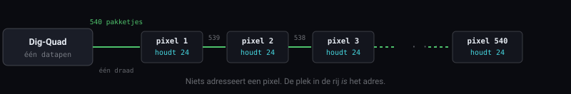
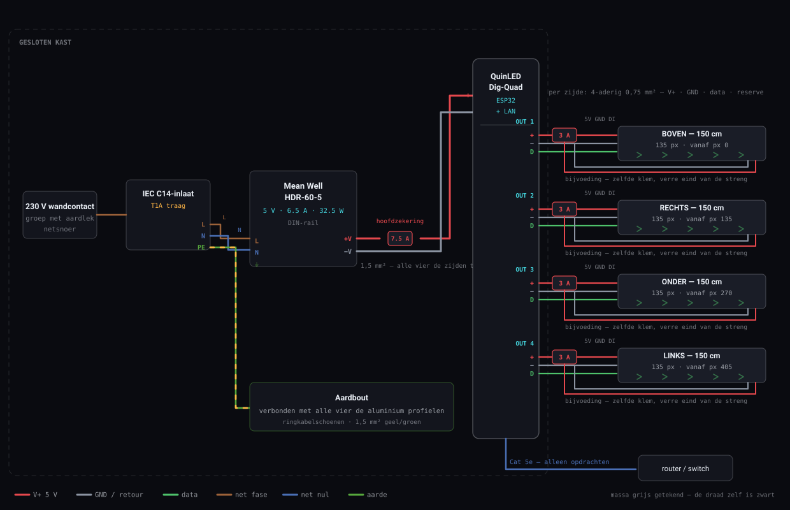
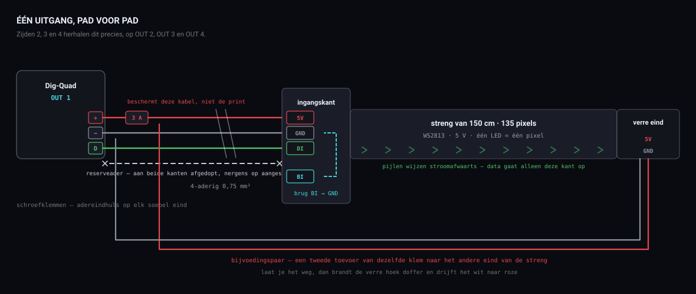

*L.I.F.E. · Fase 1 · Bouwhandleiding*

# Het frame aan de praat krijgen

Eén frame, 150 × 150 cm, in twee builds. Alles van welke strip je koopt tot welke ader waar hoort, waarom elk ervan er zit, en wat je ziet als het misgaat. Build A is de 5 V-strip die al in je profielen zit; Build B is het 24 V RGBW-frame dat het wordt.

## Deel I · Kiezen

### 00 · De twee builds, en in welke deze handleiding geschreven is

Zelfde frame, zelfde karkas, zelfde controller, zelfde bedrading, zelfde software. Alleen de strip en de voeding verschillen — en daarom is het prototype überhaupt de moeite waard.

**Build A · wat je nu bouwt — 5 V WS2813, zit al in je profielen**

- Pixels: 540 · 135 per zijde
- Voeding: Mean Well HDR-60-5
- Helderheidsbegrenzer: AAN · 5000 mA
- Kost je: niets extra aan LED’s

**Build B · het frame dat het wordt — 24 V FCOB WS2814 RGBW**

- Pixels: 84 · 21 per zijde
- Voeding: Mean Well LRS-200-24
- Helderheidsbegrenzer: UIT
- Kost je: twee rollen van 5 m en een voeding

> **Waar elk van beide staat.** Build B wordt beslist in § 01, en zijn cijfers staan naast die van Build A in § 09 (WLED-instellingen), § 11 (vermogensbudget) en § 12 (materiaallijst). Al het andere — het draadregister, beide tekeningen, de bouwstappen en de storingstabel — is geschreven in **de getallen van Build A**, want dat is het frame dat voor je staat. Wat er verandert als je naar B gaat zijn de strip, de voeding en die drie secties; niets anders in deze handleiding.

### 01 · Kies eerst de strip

Dit is de strip van **Build B** — het frame waar je op uitkomt. Build A, het prototype in sectie 02, ligt al vast door wat je hebt. Alles wat daarna komt — aantal pixels, voeding, zekering, draaddikte — volgt eruit. Beide opties hieronder zijn dezelfde familie (WS2814 four-in-one RGBW in een COB/FCOB-uitvoering), dus beide geven die doorlopende lichtlijn zonder zichtbare puntjes. Ze verschillen in hoe fijn je ze kunt aansturen en hoeveel stroom er door het frame loopt. Cijfers gelden voor een **omtrek van 6 m**, vier zijden van 150 cm.

**Aanbevolen — 24 V FCOB WS2814 RGBW**

- Adresseerbare steek: 71 mm
- Pixels per zijde: 21
- Pixels totaal: 84
- Verbruik: 20 W/m → 120 W
- Stroom bij vol: 5,0 A
- Per zijde: 1,25 A

**Alternatief — 12 V FCOB WS2814 RGBW**

- Adresseerbare steek: 62 mm
- Pixels per zijde: 24
- Pixels totaal: 96
- Verbruik: 18 W/m → 108 W
- Stroom bij vol: 9,0 A
- Per zijde: 2,25 A

Neem de **24 V**. Je wint bijna niets met de 9 mm fijnere steek van 12 V, en je betaalt ervoor met bijna dubbele stroom — dikkere draad, meer spanningsval over 1,5 m, meer warmte in elke klem. Het ene getal waar je je op moet voorbereiden: **84 pixels, geen honderden**. COB-strips schakelen hun LED's in serie-groepjes om aan de voedingsspanning te komen, dus één adresseerbare pixel is een stuk van 7 cm. Het licht is doorlopend; de *controle* erover is grofkorrelig. Op 150 cm zijn dat nog altijd 21 stappen verloop per zijde en een spark ter grootte van een vuist — prima — maar het is een kwart van wat de mock-up van de controller aanneemt, dus zet dat getal eerlijk in WLED en in de app.

Controleer de knipsteek op precies de rol die je bestelt; die verschilt tussen producten binnen dezelfde familie. Je hebt **twee rollen van 5 m** nodig — uit één rol komen drie strengen van 150 cm en je hebt er vier nodig.

> **Twee getallen op de productpagina, en maar één ervan is het aantal pixels.** Een rol die adverteert met *784 LED’s/m* vertelt je de LED-dichtheid — dat is het getal dat die naadloze neonlijn koopt, en alles vanaf ongeveer 576/m ziet er doorlopend uit. Het aantal pixels is het andere getal: 14 adresseerbare segmenten per meter, **21 per zijde**. Tik 784 in WLED en er werkt niets.

> **Let bij het bestellen op de naam van de IC.** WS2811 en SM16704 zijn driekanaals RGB-controllers — een strip daarop kan geen wit maken, wat de titel van de advertentie ook beweert. RGBW op 12 V of 24 V is **WS2814**; SK6812 is de 5 V-tegenhanger. Vraag ook naar de kleurtemperatuur van het witte kanaal: **2700–3000 K warmwit** is de flatteuze keuze voor de huid, en dat is precies waar een frame waar mensen in staan om draait.

### 02 · Build A — het frame op ware grootte, nu

Het frame is 150 cm; dat is het uitgangspunt, geen variabele. **De strip heb je al en hij zit al in het profiel** — vier strengen, klaar om aan te sluiten — dus Build A kost je verder niets aan LED’s. Je hebt deze week een frame op ware grootte dat volledig werkt, op een voeding die je al bezit, met zes keer de pixeldichtheid van de uiteindelijke build. Alles behalve de strip en de voeding gaat rechtstreeks mee naar Build B: het karkas, de controller, de bedrading, de kast, de software. De profielen gaan ook mee *als* hun binnenmaat een COB van 10 mm aankan — meet het profiel voordat je dat aanneemt. Die ene maat is het verschil tussen een strip verwisselen en alle vier de zijden opnieuw monteren.

| Build A              | Waarde                  | Toelichting                                                                                                                            |
|----------------------|-------------------------|----------------------------------------------------------------------------------------------------------------------------------------|
| Framemaat            | 150 × 150 cm            | zoals ontworpen — er past een mens in                                                                                                  |
| Strip                | in bezit                | al op maat en gemonteerd in aluminium profiel, vier strengen — niets bij te kopen — dit was de andere post met levertijd en die is weg |
| Pixels               | 540                     | 135 per zijde, steek 1,1 cm — tegenover 21 per zijde bij de 24 V COB                                                                   |
| Voeding              | HDR-60-5                | **in bezit** · 5 V · 6,5 A · 32,5 W, DIN-rail, afgeschermde klemmen                                                                    |
| Verbruik bij vol wit | 32,4 A                  | 540 × 60 mA — vijf keer wat de voeding levert                                                                                          |
| Bruikbaar plafond    | ≈20 % wit               | verzadigde kleuren gaan veel helderder; alleen wit wordt begrensd                                                                      |
| Bedrading            | 4 × 1,5 m               | één streng per zijde, elk gevoed vanaf zijn eigen uitgang                                                                              |
| Bijvoeden            | als de uiteinden zakken | 1,5 m op 5 V is grensgeval — voed dan ook het verre eind van een streng                                                                |

> **Zet de helderheidsbegrenzer hier AAN.** Het omgekeerde van het advies bij Build B, en met goede reden: de rekenwijze van ABL is gebouwd rond 5 V-strips, dus hier klopt hij. Zet de maximale stroom op **5000 mA**, als 4 × 1250 mA per uitgang (§ 08, stap 09), en WLED begrenst de helderheid zelf in plaats van weg te zakken. Waarom 5000 en geen 6000: 6000 mA is 92 % van de 6,5 A van de voeding, continu, in een dichte kast, met de ESP32 op dezelfde 5 V. Met 5000 mA draait de voeding op zo'n 77 % en blijft hij koel genoeg om een hele avond aan te staan.

> **Tel de LED’s voordat je iets instelt.** De advertentie zegt zowel “90 LED’s/m” als “100 pixels/m”, en dat kan niet allebei kloppen — bij WS2813 is één LED één pixel. Tel de LED’s in 10 cm en vermenigvuldig; dat getal gaat in WLED, niet wat de advertentie beweert. Je koopt van deze strip niets meer bij: de vier strengen zijn al geknipt en zitten in de profielen.

Twee dingen kan deze build niet. Mensen warm fotograferen — WS2813 is RGB, dus zijn wit wordt uit drie kleuren gemengd en oogt dun en iets groenig op de huid. En met 32 W tegenover de 120 W van Build B is het een sfeerlicht voor een donkere ruimte, geen fel licht; dat past bij de referentiefoto’s maar niet bij een verlichte ruimte. Koop géén grotere 5 V-voeding om dat op te lossen: dat is 30 A voeding voor een strip die je gaat vervangen. Steek dat geld in de COB en leef met het plafond.

Wil je liever niets uitgeven aan een strip die je toch afdankt, dan is het alternatief: knip er een meter af voor de werkbank, bewijs de software daarop, en bouw het frame in één keer in RGBW. Je verliest de speeltuin op ware grootte; je bespaart de bijkoop.

### 03 · Zeven correcties op het v1.0-plan

Wat er veranderd is tussen het plan dat je schreef en dat in deze handleiding, en waarom. De volledige redenering staat verderop; de pijlen wijzen waar.

#### 01 · COB gaat niet om een hoek — dwing hem er dus niet toe

Vier losse strips van 150 cm, één per zijde, elk op zijn eigen uitgang van de Dig-Quad. Er gaat geen data om een hoek, alleen stroom — en elke zijde wordt vanzelf een WLED-segment, precies zoals de app al over het frame denkt. Hiermee is Dig-Uno tegenover Dig-Quad beslist: neem de **Quad**.  
→ § 06 — de pijl, en de vier hoeken

#### 02 · Eén voeding, geen vier

In het v1.0-plan stond een Mean Well per zijde. Gebruik er één — en de reden is niet de prijs, het is de massa. Vier voedingen betekent vier verschillende ideeën over wat nul volt is, en je zou ze toch aan elkaar moeten doorverbinden voordat de data geldig is.  
→ § 06 — wat “massa” werkelijk betekent

#### 03 · Zet de spanning in omgekeerde volgorde op

Jouw stap 2 begint met de voeding op 230 V aansluiten. Maak daar de **laatste** handeling van, niet de eerste. Bedraad de DC-kant helemaal, controleer de polariteit op elke klem, en zet dan pas spanning erop.  
→ § 08 — stap 07

#### 04 · De twee voedingen zijn verschillend gebouwd — behandel ze ook verschillend

**Build B — de LRS is een open voeding.** Mean Well LRS-units hebben van huis uit blootliggende 230 V-schroefklemmen en een aardklem (FG); ze zijn bedoeld om in een kast te worden ingebouwd, met die aardklem aangesloten. **Build A — de HDR-60-5 is dat niet.** Het is een DIN-railvoeding in klasse II: afgedekte klemmen en helemaal geen aardklem, dus via hem wordt niets in de kast geaard. Wat beide builds delen, in een kunstwerk waar publiek in gaat staan: gesloten kast, trekontlaste IEC-inlaat, **aluminium profielen geaard**, groep met aardlekschakelaar. Laat een elektricien er één keer naar kijken voordat dit ergens publiek staat.  
→ § 06 — de aardleiding

#### 05 · De helderheidsbegrenzer van WLED klopt bij de ene build en niet bij de andere

**Aan** op 5000 mA bij Build A, waar de voeding met opzet kleiner is dan het worstcase. **Uit** bij Build B, waar dezelfde rekensom zinloos is en de voeding het echte worstcase gewoon dekt.  
→ § 08 — stap 09

#### 06 · De Pi houdt het licht niet tegen

Stap 1 tot en met 3 van je plan leveren een volledig werkend, via de app bestuurbaar lichtframe op zonder dat er een Pi aan te pas komt — WLED doet alles. De Pi verdient zijn plek in fase 2, wanneer een camera of microfoon de verlichting moet aansturen. Hij kan de controller ook niet vervangen, en dat is de vraag die je beter kunt beantwoorden voordat iemand hem stelt.  
→ § 04 — waarom dit de Raspberry Pi uitsluit

#### 07 · Richt het licht op de persoon, niet op de muur

In je notitie staat: LED's naar binnen of naar de muur richten. Dat zijn twee verschillende kunstwerken. Naar de muur gericht krijg je de halo; alleen **naar binnen** verlicht degene die in het frame staat, en dat is precies het effect waarop de referentiebeelden zijn gebouwd. Naar binnen is de hoofdstreng. Wil je de halo er ook bij, dan is dat een tweede strip die naar achteren straalt — iets voor fase 1.5, en de Dig-Quad heeft er een uitgang voor over.

## Deel II · Begrijpen

### 04 · Het ene idee waar al het andere aan hangt

Voordat één kabel logisch wordt, moet dit dat zijn. Het is het verschil tussen bedraden volgens instructie en bedraden met begrip.

Je strip is geen lamp. Het zijn **540 kleine computertjes op een rij**, elk met een rode, een groene en een blauwe LED en een chip die maar één ding kan: luisteren.

De controller stuurt één lange stoot over één draad: 24 bits voor pixel 1, dan 24 voor pixel 2, en zo 540 keer. Elke chip slikt de eerste 24 bits die hij hoort, zet zijn eigen drie LED's op die helderheid, en geeft al het overige door aan zijn buurman. Er is geen adressering, geen antwoord, geen bevestiging. **De plek van een pixel in de rij is zijn enige identiteit.**

- **De strip werkt maar één kant op.** Dat betekenen die kleine pijltjes die erop gedrukt staan. Voer je data aan de verkeerde kant in, dan staat pixel 540 te luisteren aan een deur waar niemand op klopt.
- **Eén dode chip doodt alles wat erachter zit.** Niet omdat de stroom stopt — omdat het bericht stopt. Gaat zijde twee vanaf de negentigste LED donker, dan zoek je één kapotte chip, geen bedradingsfout.
- **Het aantal moet exact kloppen.** Zeg je WLED 540 terwijl het er 500 zijn, dan vallen de laatste 40 pakketjes aan het eind van de strip het niets in. Zeg je 500 terwijl het er 540 zijn, dan krijgen de laatste veertig pixels nooit iets te horen en blijven ze donker.
- **Over timing valt niet te onderhandelen.** Een nul en een één zijn dezelfde puls van 1,25 µs met een andere vorm — zo'n 400 nanoseconden verschil. Er is geen klokdraad die beide kanten gelijk houdt, dus de strip vertrouwt blind op de stopwatch van de controller.

> **Verder lezen — waarom dit de Raspberry Pi uitsluit**
>
> 400 nanoseconden is ongeveer de tijd die licht nodig heeft om een kamer over te steken. Om dat vol te houden mag een chip op dat moment helemaal niets anders doen.
>
> De ESP32 op je Dig-Quad heeft daar speciale hardware voor — hij klokt de pulsen uit een randapparaat terwijl de processor gewoon doorgaat met andere dingen. Hij kan niet onderbroken worden, omdat de processor het werk niet doet.
>
> Een Raspberry Pi draait Linux, en dat is gebouwd om *eerlijk* te zijn, niet om *stipt* te zijn. Hij pauzeert je programma zonder aarzelen een halve milliseconde voor de netwerkkaart. Een halve milliseconde is vierhonderd pixels onzin.
>
> Vandaar de taakverdeling: **de controller maakt licht, de Pi neemt beslissingen.** In fase 2 kijkt de Pi naar een camera en zegt “warmer, feller, van links” — en de ESP32 vertaalt dat naar 12.960 precies gevormde pulsen.

**540 — Pixels** · 135 per zijde, bij 90 LED's per meter. Tel ze in 10 cm om het zeker te weten.

**≈ 4 ms — Per beeld** · 135 pixels × 24 bits van 1,25 µs op elke uitgang. De vier uitgangen zenden tegelijk, dus de langste streng bepaalt de tijd, niet alle 540 pixels achter elkaar. Dat zou ruim 200 beelden per seconde toelaten; de eigen verversingssnelheid van WLED (standaard 42 per seconde) is de echte grens, niet de draad.

**32 A — Zonder begrenzing** · Wat 540 RGB-pixels op vol wit zouden trekken als niets ze tegenhield.

**6.5 A — Wat je hebt** · Het plafond van de HDR-60-5. Vijf keer minder. Daarom is de begrenzer niet optioneel.

### 05 · De vier dingen op je werkbank

Elk ervan doet precies één ding. Als je weet welk ding, wordt de bedrading vanzelfsprekend in plaats van iets dat je uit je hoofd leert.

#### Mean Well HDR-60-5 — energie

Zet 230 V wisselspanning om in **5 V stabiele gelijkspanning**, tot 6,5 A. Verder raakt niets in de kast netspanning aan.

> **Verder lezen — wat een voeding eigenlijk doet**
>
> Netspanning zwaait vijftig keer per seconde van +325 V naar −325 V en terug. LED's en logica-chips kunnen daar niets mee; die hebben een spanning nodig die stilzit.
>
> De HDR hakt de netspanning in pulsen van tientallen kilohertz, stuurt die door een kleine trafo, gelijkricht het resultaat en vlakt het af. Wat er aan de laagspanningskant uit komt is 5 V die **stabiel blijft wat je er ook op aansluit** — precies tot je meer dan 6,5 A vraagt, en dan beschermt hij zichzelf door weg te zakken of uit te schakelen.
>
> Die laatste zin is de hele reden voor de helderheidsbegrenzer. De voeding ontploft niet als je hem overbelast; hij houdt gewoon op 5 V te zijn, en alles erachter gaat tegelijk raar doen.

#### QuinLED Dig-Quad — vertaling

Een ESP32 met WLED erop, plus vier apart gezekerde uitgangen. Hij verandert **een opdracht van je telefoon in exact getimede pulsen** — en tilt die pulsen van de 3,3 V van de ESP32 naar de 5 V die de strip verwacht.

> **Verder lezen — de levelshifter, en waarom die print überhaupt bestaat**
>
> Een ESP32 spreekt op 3,3 V. Een WS2813 op 5 V ziet iets pas als een “1” boven ongeveer 3,5 V. Een kale ESP32 zit dus net onder de drempel — hij werkt op een kort draadje op de werkbank op een koele dag, en faalt op een warme avond met een meter kabel.
>
> De Dig-Quad heeft een **levelshifter** aan boord: een chip die het zwakke 3,3 V-signaal leest en het opnieuw uitstuurt als een schoon, volwaardig 5 V-signaal. Daar betaal je grotendeels voor. De rest zijn de zekeringhouders, de schroefklemmen, en het feit dat iemand anders de massa-indeling goed heeft ontworpen.
>
> Je hebt de LAN-versie genomen. Goede keuze — de antenne van de ESP32 komt zo meteen omringd te staan door vier aluminium profielen, en dat is bijna een kooi van Faraday.

#### Vier strengen WS2813 van 150 cm — licht

Al op maat geknipt en in je profielen gelegd. Elke streng heeft **drie aansluitingen aan de ingangskant** nodig — 5 V, massa, data — en, bij 5 V over anderhalve meter, **nog twee aan het verre eind**.

> **Verder lezen — waarom WS2813 een extra datapad heeft**
>
> WS2813 is de dubbelsignaal-versie van de bekende WS2812. Naast de gewone data-ingang `DI` zit er een reserve-ingang `BI`, zo bedraad dat elke pixel ook de pixel *twee* plaatsen eerder hoort.
>
> Het gaat om storingstolerantie: gaat één chip stuk, dan ontvangt de volgende het bericht nog via zijn reservelijn en blijft de streng werken. Bij een gewone WS2812 legt één dode chip alles erachter plat.
>
> Pixel één heeft niets vóór zich, dus zijn `BI` heeft geen bron. Los laten hangen werkt meestal wel. Verbind je hem met het `GND`-pad ernaast, dan krijgt hij een vast niveau en heb je één verdachte minder op de dag dat de eerste pixel zich misdraagt — dertig seconden met de bout die toch al heet is.

#### Raspberry Pi — nog niet

Hij zit **niet in dit circuit**. Hij heeft zijn eigen USB-voeding en raakt het frame alleen via het netwerk. Je kunt fase 1 afmaken en laten zien zonder hem ooit uit te pakken.

### 06 · Elke draad, en wat hij doet

Dit is het register. De kleurbalkjes zijn de echte mantelkleuren, zodat je ze kunt vergelijken met wat je in je hand hebt. Lees het één keer door voordat je iets stript.

#### In de kast — netspanningszijde

*230 V*

##### Fase — bruin · 1,0 mm²

`IEC C14-inlaat → HDR-60-5 · L`

Dit is de gevaarlijke. Hij brengt de 230 V vanuit de muur naar de voeding. **De zekering in de IEC-inlaat zit in deze ader**, zodat een storing als eerste de fase onderbreekt.

##### Nul — blauw · 1,0 mm²

`IEC C14-inlaat → HDR-60-5 · N`

De terugweg. Stroom die er via bruin in gaat, komt er via blauw weer uit — **precies evenveel, altijd**. Op die gelijkheid let een aardlekschakelaar.

##### Aarde — geel/groen · 1,5 mm²

Build A: `aardpen IEC → eigen wartel → alle vier de aluminium profielen`  
Build B: `aardpen IEC → aardbout kast → LRS · FG en alle vier de aluminium profielen`

Deze draad doet niets. Elke dag, jarenlang, voert hij geen enkele stroom. Hij bestaat voor **die ene seconde waarin een spanningvoerende ader metaal raakt** — dan geeft hij die fout een pad dat zó gemakkelijk is dat er onmiddellijk honderden ampères lopen en de aardlekschakelaar eruit vliegt, in plaats van dat de stroom zijn weg zoekt door degene die tegen het frame leunt.

**Hoe hij loopt verschilt per build.** De HDR-60-5 van Build A is klasse II — dubbel geïsoleerd, geen aardklem — dus de aarde kan in de kast nergens op landen. Hij gaat rechtstreeks van de aardpen van de inlaat via een eigen wartel naar de profielen: een ringkabelschoen op elk van de vier, zijde aan zijde doorverbonden, want anodiseerlaag geleidt niet en een hoekverbinding is geen aardpad. De LRS van Build B is klasse I, dus zijn FG-klem moet ook geaard worden: daar landt de draad eerst op een aardbout in de kast, met één draad naar de LRS en één naar buiten naar de profielen.

> **Verder lezen — waarom juist de profielen**
>
> Je frame is een rechthoek van blootliggend aluminium waar mensen worden uitgenodigd in te gaan staan en het aan te raken, en het deelt een kast met 230 V — achter afdekkingen bij de HDR van Build A, op open schroefklemmen bij de LRS van Build B, maar hoe dan ook in dezelfde kast. Werkt er ooit een draadje van de fase los en landt het op het chassis, dan staat het aluminium onder spanning en merk je er niets van.
>
> Met aardverbinding wordt datzelfde ongeluk een regelrechte kortsluiting. De aardlekschakelaar ziet het verschil tussen bruin en blauw — stroom die weggaat en niet terugkomt — en schakelt binnen 40 milliseconden af.
>
> **Ringkabelschoenen, geen draadje onder een schroef geklemd.** Deze verbinding moet jaren transport en trillingen overleven, want als hij het begeeft merk je dat nooit.

#### Van voeding naar controller — de hoofdtoevoer

*draagt alle vier de zijden*

##### V+ hoofdtoevoer — rood · 1,5 mm²

`HDR · +V → ATO-zekering 7,5 A → Dig-Quad · +`

Elke ampère die het hele frame trekt gaat door deze ene draad — tot 6,5 A. Daarom is het de dikste ader op de print, en daarom is het de enige met een eigen zekering.

> **Verder lezen — de zekering beschermt de kabel, niet de print**
>
> Dit is het meest misbegrepen onderdeel in elke DC-installatie, dus laten we precies zijn: **een zekering beschermt de draad erachter.** Hij zit er niet om de Dig-Quad te redden.
>
> Denk na over wat kortsluiting is. Raken rood en zwart elkaar ergens tussen de voeding en de print, dan is het enige dat de stroom begrenst de weerstand van de kabel zelf — en die is bijna nul. De voeding duwt daar zo hard tegenaan als hij kan. De kabel is nu een verwarmingselement, in een gesloten kast, en er staat alleen nog niets in brand omdat de voeding het als eerste opgaf.
>
> De 7,5 A komt van de kabel: 1,5 mm² kan daar veilig ruim overheen, dus de zekering gaat lang voordat de isolatie warm wordt. Hij ligt **boven** je werkstroom (6,5 A) en **onder** wat de kabel aankan. Dat is de hele berekening.
>
> Halfgeleiders kun je overigens helemaal niet met zekeringen beschermen. Die gaan stuk in microseconden; een zekering doet er milliseconden over. De zekering is er voor het koper en de kast.

##### Massaretour — zwart · 1,5 mm²

`HDR · −V → Dig-Quad · −`

De weg terug. Stroom is een kring — er wordt niets “opgebruikt” in de LED's. Elke ampère die via rood weggaat komt via dit zwart terug. Hij doet nog iets tweeds dat niets anders kan: **hij is het referentiepunt waartegen elke datapuls gemeten wordt**.

> **Verder lezen — wat “massa” werkelijk betekent, en waarom het het antwoord is op de helft van alle LED-storingen**
>
> “5 volt” is geen eigenschap van een draad. Het is een *verschil* tussen twee punten. Zeggen dat de rode draad op 5 V staat is betekenisloos tot je erbij zegt waar hij 5 V bóven staat — en dat ding is de massa.
>
> Pas dat nu toe op de datalijn. Als de Dig-Quad een “1” stuurt, tilt hij de datadraad naar 5 V. Maar de pixel aan het verre eind meet die 5 V niet ten opzichte van de massa van de controller — hij meet ten opzichte van **zijn eigen** massa, waar die op dat moment ook staat.
>
> Delen beide kanten een dikke, korte massadraad, dan zijn dat hetzelfde en leest de pixel precies wat er verstuurd is. Is de massa dun, lang, gecorrodeerd of — het ergst van al — afwezig omdat twee losse voedingen elk hun eigen massa hebben, dan meet de pixel het signaal tegen een ander nulpunt. Een “1” kan aankomen als een “0”. Je krijgt flikkering, verkeerde kleuren, willekeurige pixels of helemaal niets, en niets daarvan ziet eruit als een massafout.
>
> **Hierom is één voeding beter dan vier.** Niet vanwege de prijs. Vier voedingen betekent vier verschillende ideeën over wat nul is, en je zou ze toch allemaal aan elkaar moeten doorverbinden om de data geldig te maken — waarmee je precies uitkomt waar één voeding je al had gebracht, met drie extra netaansluitingen als aankoop.
>
> Doet een adresseerbare strip raar terwijl de bedrading er “prima uitziet”, verdenk dan de massa — eerst, tweede en derde.

#### Van controller naar elke zijde

*4-aderig, × 4*

##### V+ — rood · 0,75 mm²

`Dig-Quad-uitgang · + → ATO-zekering 3 A → 5 V-pad van de strip`

Voedt één zijde, hooguit 1,25 A zodra de begrenzer zijn werk doet. De zekering van 3 A beschermt **deze dunnere kabel**, en daarom is het een kleiner getal dan bij de hoofdtoevoer — dunnere draad, lagere zekering.

##### GND — zwart · 0,75 mm²

`Dig-Quad-uitgang · − → GND-pad van de strip`

Retourweg *én* signaalreferentie, in dezelfde draad. Leg nooit een datalijn naar een strip zonder de massa ernaast — zonder die massa wordt de data betekenisloos, ook al brandt de strip van stroom die hij ergens anders vandaan haalt.

##### DATA — groen · 0,75 mm²

`Dig-Quad-uitgang · D → DI-pad van de strip · pijl wijst wég`

Het hele beeld, één zijde ervan, vele keren per seconde — 42 bij de standaard verversingssnelheid van WLED. **Er loopt hier geen noemenswaardige stroom** — het is een spanning die wiebelt. Deze draad zou haardun kunnen zijn en perfect werken; hij is 0,75 mm² alleen omdat hij in dezelfde mantel zat als de rest.

> **Verder lezen — de pijl, en de vier hoeken**
>
> Zoek de kleine pijltjes die langs de strip gedrukt staan. Ze wijzen **stroomafwaarts** — de kant waar het bericht heen gaat. Je datadraad komt op het pad waar de pijlen *vandaan* wijzen. Draai je het om, dan doet de strip helemaal niets; geen foutmelding, geen half werken, gewoon donker.
>
> Die eenrichtingsstroom is ook de reden dat elke zijde zijn eigen uitgang krijgt. Zou je één doorlopende datalijn om alle vier de zijden leggen, dan had elke hoek een soldeerverbinding nodig die een puls van 1,25 microseconde draagt — en juist een hoekverbinding is wat er tijdens transport losraakt. Eén kapotte hoek en alles erachter wordt zwart.
>
> Vier uitgangen betekent dat **er nooit data om een hoek gaat**. Alleen stroom doet dat, en stroom heeft er geen last van als hij een microseconde onderbroken wordt.

##### Reserveader — wit · 0,75 mm²

`aan beide kanten afgewerkt · nergens op aangesloten`

Bewust ongebruikt. Je trekt kabel door een frame dat je zo dichtmaakt, en op de dag dat je een reservedatalijn, een temperatuursensor of een tweede strip naar buiten toe wilt, is dit **het verschil tussen een middag en een verbouwing**. Dop hem af, label hem, vergeet hem.

#### Bijvoeden — de verre uiteinden

*2-aderig, × 4*

##### V+ en GND, tweede toevoer — rood + zwart · 0,75 mm²

`dezelfde uitgangsklem → het verre eind van de strip van die zijde`

Loopt langs de strip mee en voedt hem ook vanaf de andere kant. **Geen data** — alleen stroom. Bij 24 V zou je dit kunnen overslaan. Bij 5 V over 150 cm niet.

> **Verder lezen — waarom 5 V wegzakt waar 24 V dat niet doet**
>
> De koperbanen die langs een flexibele strip gedrukt zijn, zijn dun — veel dunner dan de draad die ze voedt. Duw daar een paar ampère doorheen over 150 cm en je verliest tegen het verre eind zo'n derde van een volt.
>
> Een derde volt van 24 V is één procent. Niemand ziet dat. Een derde volt van 5 V is **zes procent**, en dat zie je absoluut — de verre hoek van het frame is zichtbaar doffer dan de dichtstbijzijnde.
>
> Erger nog: het dimt niet gelijkmatig. Blauwe LED's hebben de meeste spanning nodig om te branden (rond 3,2 V, tegen 2,0 V voor rood), dus blauw verhongert het eerst. **Je wit drijft richting het verre eind naar roze en oranje** terwijl het rood in orde blijft. Bij een kunstwerk dat als enig doel heeft mensen flatteus te belichten, is dat geen detail waar je mee kunt leven.
>
> Beide uiteinden voeden halveert de afstand die stroom door de strip moet afleggen, en de spanningsval verdwijnt grotendeels. Trek deze kabels *nu*, nu het frame nog open is.

#### Netwerk

*hier gaat geen licht doorheen*

##### Ethernet — Cat 5e

`LAN-poort Dig-Quad → router of switch`

Draagt **alleen opdrachten** — “zijde twee, warmwit, 70 procent”. Een paar bytes, af en toe. Trek hem er middenin een voorstelling uit en het frame gaat eindeloos door met precies wat het als laatste te horen kreeg. Dat is het waard om te weten: **het netwerk is geen levenslijn, het is een afstandsbediening.**

> **Verder lezen — waarom je voor kabel koos in plaats van wifi**
>
> De antenne van de ESP32 komt straks in een vierkant van aluminium profiel te zitten. Metaal weerkaatst radiogolven; zo'n frame komt dicht genoeg bij een afgeschermde kast om wifi onbetrouwbaar te maken, precies op die onvoorspelbare manier die een tentoonstelling verpest.
>
> Kabel haalt die hele categorie problemen weg — en haalt hem weg op een locatie waar je nooit bent geweest, op een netwerk dat je niet beheert, op de enige avond die telt.
>
> Zet er meteen een vast adres voor in de router (een **DHCP-reservering**). Een installatie waarvan het adres verspringt is een installatie die stukgaat op de dag van de voorstelling, altijd waar mensen bij staan.

### 07 · Het geheel, getekend

Elke ader van het stopcontact tot de laatste pixel, op één blad. Tik op een tekening om hem schermvullend te openen en in te zoomen.

Build A, compleet. De netspanning komt links binnen en stopt bij de voeding — niets rechts van de HDR-60-5 komt boven 5 V. Elk van de vier uitgangen is apart gezekerd en draagt zijn eigen stroom, massa en data; er gaat nooit data om een hoek van het frame.

Eén uitgang tot op padniveau. De reserveader, het bruggetje naar de reserve-ingang en het bijvoedingspaar zijn de drie dingen die je makkelijk vergeet en lastig later nog toevoegt.

## Deel III · Bouwen

### 08 · De bouw, op volgorde

De volgorde is zo gekozen dat elke onomkeerbare handeling pas komt ná datgene wat je ervoor gewaarschuwd zou hebben. Wissel hem niet om, zeker de laatste drie niet.

1.  #### Flash WLED met verder niets aangesloten

    **Doen:** sluit de Dig-Quad met USB op je computer aan, open install.wled.me in Chrome of Edge, en installeer de **ESP32 Ethernet**-build — die meldt zich als `ESP32_Ethernet`; de gewone ESP32-build heeft geen ethernetdriver, en dan doet de kabel niets. Geen voeding, geen strip, niets in de klemmen.

    Je bewijst dat de print levend is aangekomen terwijl er niets aan hangt dat beschadigd kan raken en niets dat de diagnose kan vertroebelen. Mislukt deze stap, dan weet je zeker dat het de print of de kabel is — en dat is later heel wat waard, wanneer er iets stukgaat en je één ding nodig hebt dat je kunt vertrouwen.

2.  #### Tel de LED's en leg het getal vast

    **Doen:** meet 10 cm strip af en tel de LED's erin. Vermenigvuldig. Bij 90 per meter moet je er 135 vinden in een streng van 150 cm, en 540 over vier strengen.

    Elke latere instelling hangt van dit ene getal af, en productadvertenties spreken zichzelf er standaard over tegen. Bij WS2813 is één LED één pixel, dus tellen is doorslaggevend op een manier die de advertentie lezen niet is. Schrijf het getal op een stuk tape en plak dat op de werkbank.

    > **Let op:** een advertentie die zowel “90 LED's/m” als “100 pixels/m” noemt, kan niet allebei gelijk hebben. Je ogen beslechten het in dertig seconden.

3.  #### Zet draadstaarten op de ingangskant van elke streng

    **Doen:** soldeer rood, zwart en groen aan de pads 5V, GND en DI, aan de kant waar de pijlen vandaan wijzen. Krimpkous over elke verbinding. Nu de bout toch heet is: verbind het BI-pad van pixel één met de GND ernaast.

    Die pads zijn koperfolie op plastic geplakt. Ze laten los als je eraan trekt, en een losgelaten pad betekent de eerste pixel eraf knippen en een centimeter verderop opnieuw beginnen. De krimpkous is trekontlasting, geen isolatie.

    > **Jouw strip zit al in het profiel,** en dat is niet wat de ideale volgorde aanneemt — solderen in een gemonteerd profiel is echt onaangenaam. Wrik de laatste 30 mm uit het profiel, werk er plat op de werkbank aan, en druk hem daarna terug. Komt een streng er niet uit zonder schade, dan zijn soldeerloze klemconnectoren een prima oplossing voor een prototype; meet ze wel door, want het is de minst betrouwbare verbinding in de hele bouw.

4.  #### Meet elke draadstaart door voordat er ooit spanning op komt

    **Doen:** multimeter op doorgang. Houd rood en zwart van elke staart tegen elkaar. Hij mag *niet* piepen. Controleer daarna dat rood ook echt bij het 5 V-pad uitkomt en zwart ook echt bij GND.

    Twee draden op één klein padje met een klodder soldeer is precies de plek waar een losse draadader de rails overbrugt. Bestaat die brug, dan ziet de voeding op het moment dat je spanning geeft een regelrechte kortsluiting — en de Dig-Quad betaalt het gelag. Tien seconden per staart, vier staarten.

5.  #### Laat één streng branden op de werkbank

    **Doen:** één strip, één uitgang, voeding aangesloten, alles los op de werkbank. Krijg hem aan. Stuur puur rood vanuit WLED en kijk wat er werkelijk uit komt.

    Je test vier losse aannames tegelijk — dat de rol goed is, dat je soldeerwerk deugt, dat het aantal pixels klopt, en dat de kleurvolgorde is wat je denkt. Nu ontdekken dat er één niet klopt kost minuten. Het ontdekken nadat het frame dicht zit kost een middag.

    > **Verwacht dit:** laat de eerste pixel onzin zien terwijl alles erachter klopt, dan is dat het 3,3 V-drempelprobleem en geen kapotte strip — pixel één schoont het signaal op voor de rest. De Dig-Quad heeft een levelshifter aan boord die dat zou moeten voorkomen. Zie je het toch, vergelijk dan eerst jouw boardrevisie met de officiële QuinLED-pinout voordat je de strip verdenkt — de indeling van de data-uitgangen is niet bij elke revisie gelijk.

6.  #### Bedraad de DC-kant helemaal, netstekker er nog uit

    **Doen:** voeding → hoofdzekering → print. Dan de staart van elke zijde in zijn eigen uitgang: rood, zwart, groen. Dan de bijvoedingsparen naar de verre uiteinden. Adereindhulzen op elk soepel draadeind. Zekeringen er als laatste in.

    Alles is spanningsloos terwijl je dit doet, dus een vergissing is gewoon een vergissing — te vinden met een meter, te herstellen met een schroevendraaier. Dit is het moment waarvoor die hele volgorde bestaat.

    > **Adereindhulzen zijn niet optioneel.** Kale soepele draad onder een schroef werkt in de loop van maanden los en wordt warm op de plek waar hij loskomt. Dat is het verschil tussen een prototype op een werkbank en iets dat een seizoen lang in een publieke ruimte hangt.

7.  #### Controleer de polariteit op elke klem, zet dan pas spanning erop

    **Doen:** loop elke schroefklem in de kast langs. Rood op +, zwart op −, geen losse draadader die ertussen oversteekt. *Dan* pas de 230 V erin.

    Omgekeerde polariteit op de ingang van de print is niets waar een zekering je van kan redden. Silicium gaat stuk in microseconden; een zekering heeft milliseconden nodig om het te merken. Je zou een vonkje zien, en de Dig-Quad zou al klaar zijn voordat de zekering warm begon te worden.

    > **De netspanning zit hoe dan ook in de kast, welke voeding je ook gebruikt.** De LRS van Build B heeft van huis uit blootliggende netklemmen. De HDR-60-5 van Build A heeft afgedekte klemmen en, als klasse II-voeding, geen aardklem — maar de fase-, nul- en aardlippen van de IEC-inlaat liggen bloot tot de kast dicht is, en de aarddraad loopt van de inlaat rechtstreeks naar de profielen (§ 06). Beide voedingen zijn componenten die bedoeld zijn om in een kast te worden ingebouwd, niet om op een werkbank naast je handen te liggen. Voordat dit ergens publiek staat: gesloten kast, trekontlaste IEC-inlaat, profielen geaard, groep met aardlekschakelaar. Een kwartier van een elektricien waard.

8.  #### Zet hem op het netwerk en zet zijn adres vast

    **Doen:** alleen de eerste keer: verbind met de hotspot WLED-AP die de print opent als hij geen netwerk heeft (wachtwoord `wled1234`) en ga naar 4.3.2.1. Zet in *Config → WiFi & Network Settings* het **Ethernet Type** op **QuinLED Uno/Quad**, laat de wifi-netwerknaam leeg en zet het mDNS-adres op life-frame. Opslaan, netwerkkabel erin en laat hem herstarten. Voeg daarna een DHCP-reservering toe in de router zodat zijn adres nooit verandert.

    Zolang het Ethernet Type niet is ingesteld, weet de print niet op welke pinnen zijn netwerkchip zit, en doet de kabel niets — daarom is de hotspot één keer nodig. *QuinLED Uno/Quad* is de keuze voor jouw v3-print; *QuinLED v4 Uno/Quad* is een andere print en werkt niet. Er zijn geen wifi-gegevens in te vullen: bij deze build is het netwerk de kabel, en precies daarom heb je de LAN-versie gekozen.

    De hostnaam is waar je Pi-scripts mee praten — life-frame.local — dus door hem nu vast te zetten heeft geen enkele latere regel code een IP-adres ingebakken.

9.  #### Vertel WLED wat hij werkelijk aanstuurt

    **Doen:** vier uitgangen van 135 pixels, beginnend op 0, 135, 270 en 405. LED-type WS281x, RGB. Kleurvolgorde getest, niet aangenomen — meestal GRB. **Helderheidsbegrenzer AAN, met *Use per-output limiter* aangevinkt en 1250 mA op elk van de vier uitgangen** — samen 5000 mA.

    Die vier startposities maken van het frame vier benoemde zijden die de app en de Pi apart kunnen aansturen. De begrenzer is de structurele: je strip kan om 32 A vragen en je voeding heeft er 6,5. Met ABL aan doet WLED die rekensom zelf en begrenst hij de helderheid zodat de vraag altijd past. Met ABL uit zakt de voeding weg, verschuiven de kleuren, en valt de ESP32 terug en herstart — wat eruitziet als een softwarefout en dat niet is.

    > **Waarom per uitgang, en niet één totaal.** De vier uitgangen delen één voeding, maar elk heeft een eigen zekering van 3 A. Eén totaal laat één zijde er bijna alles van nemen: één zijde vol wit en de andere drie zwart — precies stap 10 — vraagt zo'n 8 A (135 × 60 mA), en een totaal van 5000 mA laat daarvan bijna 5 A door een zekering van 3 A. WLED kan elke uitgang apart begrenzen (*LED Preferences → Use per-output limiter*, aanwezig sinds 0.15 en nog steeds in 16.0), maar doet het een of het ander, niet allebei: vink het aan en het totaalveld wordt de som van de vier uitgangen. Je stelt het totaal dus in door de vier getallen te kiezen — vier keer 1250 mA is dezelfde 5000 mA — en geen zijde kan ooit meer trekken dan zijn deel.

    > **Dit is de ene instelling die bij Build B precies andersom is.** ABL werkt vanuit een milliampère-per-LED-getal dat alleen bij 5 V klopt, dus hier is hij juist en op het 24 V-frame zinloos. Bij Build B zet je hem uit en dimensioneer je in plaats daarvan de voeding op het echte worstcase. Draai je het bij een van beide om, dan heb je precies de verkeerde beveiliging.

10. #### Test elke zijde apart, daarna alle vier

    **Doen:** één zijde wit, de andere drie zwart. Vier keer achter elkaar. Daarna alles aan.

    Met de begrenzer per uitgang uit stap 09 komt een zijde die alleen wit brandt nooit boven zijn eigen 1250 mA, hoe hoog je de helderheid ook zet, dus dit kan veilig op volle helderheid. Werk je ooit zonder begrenzer per uitgang, doe deze stap dan op lage helderheid: onder één totaal kan één witte zijde het grootste deel van de voeding door zijn zekering van 3 A trekken.

    Een storing in één uitgang is onzichtbaar als alle vier branden — je oog leest het frame als werkend. Ze één voor één testen is de enige manier om een half brandende zijde te vinden, een streng met een afwijkende kleurvolgorde, of een uitgang waarvan je de zekering vergat te plaatsen.

11. #### Laat hem een uur aan staan

    **Doen:** vol wit, een uur lang, leg dan je hand op de profielen en op de voedingskast.

    Warm is goed — aluminium profiel is een koellichaam en doet zijn werk. Heet is een waarschuwing, en een voedingskast die staat te bakken heeft ventilatie nodig voordat dit onbeheerd draait in een ruimte vol mensen. Dit is de test die iets dat werkt onderscheidt van iets dat je aan kunt laten staan.

### 09 · WLED-instellingen

Vier hiervan verschillen tussen de twee builds, en de verkeerde set invoeren is de meest waarschijnlijke manier om een avond te verspelen. **De linkerkolom is wat je nu invult.**

| Instelling           | Build A — 5 V, nu | Build B — 24 V, later | Waarom                                                                                                                                       |
|----------------------|-------------------|-----------------------|----------------------------------------------------------------------------------------------------------------------------------------------|
| LED-type             | WS281x · RGB      | SK6812 / WS2814 RGBW  | WS2813 heeft geen wit kanaal; WS2814 wel, en spreekt hetzelfde protocol                                                                      |
| Uitgangen            | 4 × 135 px        | 4 × 21 px             | beginnend op 0, 135, 270, 405 — tegenover 0, 21, 42, 63 — op welke build je ook zit, dit moet kloppen met wat je geteld hebt                 |
| Kleurvolgorde        | testen            | testen                | meestal GRB bij WS2813, GRBW bij WS2814 — stuur puur rood en kijk wat eruit komt                                                             |
| Auto-witmodus        | n.v.t.            | Accurate              | bij Build A is er geen wit kanaal om te regelen                                                                                              |
| Helderheidsbegrenzer | AAN · per uitgang, 4 × 1250 mA (samen 5000 mA) | UIT | de rekenwijze van ABL klopt alleen bij 5 V — zie correctie 05 — uit bij Build A en de voeding zakt weg onder de 32 A die de strip kan vragen; 5000 en geen 6000 omdat 6000 continu 92 % van de voeding is, in een dichte kast, met de ESP32 op dezelfde voeding; per uitgang, zodat geen zijde het hele budget door zijn zekering van 3 A kan trekken — zie stap 09 |
| Hostnaam             | life-frame        | life-frame            | plus een DHCP-reservering in de router                                                                                                       |

### 10 · De kant van de Pi

Drie bestanden, geen afhankelijkheden buiten de standaardbibliotheek — op een verse Pi OS hoef je niets te installeren.

`wled.py` — de client voor de JSON-API — info en status uitlezen, status toepassen, effecten op naam opzoeken

`frame.py` — het frame als vier benoemde zijden, met de moods uit de app en een kleurverloop; tevens een CLI

`test_link.py` — jouw stap 4.3 — vier controles, daarna licht elke zijde om de beurt op zodat je het met eigen ogen kunt bevestigen

    # eenmalig: schrijf de segmentindeling met vier zijden in de controller
    python3 frame.py --host life-frame.local --setup

    # bewijs de verbinding (dit is de finish van fase 1)
    python3 test_link.py --host life-frame.local

    # aansturen
    python3 frame.py --mood golden --bri 70
    python3 frame.py --sweep 8
    python3 frame.py --off

> **Eén getal bepaalt dit allemaal** **`PIXELS_PER_SIDE = 135` bovenin `frame.py`.** Dat is Build A, en `test_link.py` volgt dat nu in plaats van een eigen kopie bij te houden. Controleer het tegen de LED’s die je geteld hebt vóórdat je `--setup` draait: klopt het niet, dan krijgt de controller stilzwijgend het verkeerde aantal pixels te horen. Overstappen naar Build B is die ene regel, gewijzigd in 21.

Eén architectuurnotitie voor later: HTTP is prima voor *“ga naar amber op 70 %”* en ongeschikt voor animatie. Elke aanroep opent opnieuw een verbinding en rendert de hele status opnieuw, dus een camera-gestuurd effect gaat schokken. Zodra de Pi in fase 2 beelden moet pushen, stap dan over op **DDP over UDP** op poort 4048 — WLED luistert er standaard naar en valt terug op zijn eigen effecten zodra de stream stopt. De notitie staat al in `wled.py`, zodat je hem vindt wanneer je hem nodig hebt.

## Deel IV · Naslag

### 11 · Vermogensbudget, beide builds

Het worstcase is elk kanaal op volle helderheid over alle vier de zijden. Zo ga je hem nooit draaien, maar de voeding, de zekeringen en de draad moeten het overleven als iemand het per ongeluk doet. De twee builds pakken dat tegenovergesteld aan: **de voeding van Build A is met opzet kleiner dan het worstcase en WLED begrenst de helderheid passend; de voeding van Build B dekt het worstcase gewoon volledig.**

| Waarde                      | Build A — 5 V | Build B — 24 V   | Wat dat betekent                                                                                                                                |
|-----------------------------|---------------|------------------|-------------------------------------------------------------------------------------------------------------------------------------------------|
| Strip                       | WS2813 RGB    | FCOB WS2814 RGBW | 90 LED’s/m tegenover ≥ 576 LED’s/m                                                                                                              |
| Pixels                      | 540           | 84               | 135 per zijde tegenover 21 per zijde — Build A is fijner aan te sturen en grover om naar te kijken                                              |
| Worstcase-belasting         | 162 W         | 120 W            | elk kanaal, vol wit, vier zijden                                                                                                                |
| Stroom bij die belasting    | 32 A          | 5,0 A            | het hele argument voor 24 V, in één regel                                                                                                       |
| Voeding                     | HDR-60-5      | LRS-200-24       | 6,5 A · 32,5 W tegenover 8,8 A · 211 W                                                                                                          |
| Voeding tegenover worstcase | 5× te klein   | 57 % belast      | Build A leunt op de begrenzer; Build B niet — LRS-150-24 past ook bij Build B, op 77 % — minder marge, warmer                                   |
| Helderheidsbegrenzer        | AAN · 4 × 1250 mA per uitgang | UIT | de rekenwijze van ABL klopt alleen bij 5 V; per uitgang, zodat één zijde alleen onder zijn zekering blijft                                                                                                      |
| Zekering per uitgang        | 3 A ATO       | 3 A ATO          | beschermt de streng van 0,75 mm², niet de print; bij Build A houdt de begrenzer per uitgang elke zijde op 1250 mA                                                                                                 |
| Hoofdtoevoer DC             | 7,5 A ATO     | 7,5 A ATO        | beschermt de kabel van 1,5 mm² tussen voeding en print                                                                                          |
| Draad, voeding → print      | 1,5 mm²       | 1,5 mm²          | ≈ 16 AWG                                                                                                                                        |
| Draad, print → elke zijde   | 0,75 mm²      | 0,75 mm²         | ≈ 18 AWG, 4-aderig: V+, GND, data, reserve                                                                                                      |
| Bijvoeding                  | nodig         | niet nodig       | een derde volt is 6 % van 5 V en 1 % van 24 V                                                                                                   |
| Datatiming                  | ≈ 4 ms        | ≈ 0,8 ms         | de vier uitgangen zenden tegelijk, dus de langste telt: 135 × 24 bits tegenover 21 × 32 bits, bij 1,25 µs per bit — de draad laat bij Build A ruim 200 beelden per seconde toe en bij Build B veel meer; bij allebei is de verversingssnelheid van WLED (standaard 42) de grens |

> **De regel die mensen verrast** **32 A tegenover 5 A.** Build A lijkt de mildere build omdat het 5 V is, en het is precies andersom: drie keer zoveel LED’s, die elk hun eigen stroom trekken uit een rail met zes keer minder spanning om mee te werken. Daarom kan zijn voeding het worstcase niet dekken en is de begrenzer structureel in plaats van optioneel.

### 12 · Materiaallijst

Regels met **in bezit** liggen al in de werkplaats. Het prototype heeft alleen de vier regels voor controller en montage nodig, plus wat je al hebt; de rest is het frame van 150 cm.

| Onderdeel          | Specificatie                                                                                                                                                                                                                                                                  | Aantal     |
|--------------------|-------------------------------------------------------------------------------------------------------------------------------------------------------------------------------------------------------------------------------------------------------------------------------|------------|
| Strip — Build A    | **in bezit** · WS2813 5 V RGB, 90 LED’s/m — gemonteerd in profiel, 4 × 150 cm. 135 pixels per zijde — controleer door de LED’s in 10 cm te tellen                                                                                                                             | —          |
| Voeding — Build A  | **in bezit** · Mean Well HDR-60-5 — 5 V, 6,5 A, 32,5 W — DIN-rail, afgedekte klemmen; zet de ABL van WLED op 5000 mA                                                                                                                                                          | 1          |
| Strip — Build B    | 24 V FCOB WS2814 RGBW, ≥ 576 LED’s/m, 2700–3000 K wit, 10 mm — geknipt tot 4 × 150 cm — uit één rol komen er maar drie                                                                                                                                                        | 2 × 5 m    |
| Controller         | **besteld** · QuinLED-Dig-Quad v3, ESP32, LAN-versie — ethernet, omdat de ESP32 in een frame vol metaal zit                                                                                                                                                                           | 1          |
| Voeding — Build B  | Mean Well LRS-200-24 — 24 V, 8,8 A — LRS-150-24 kan ook, op 77 % belasting en warmer                                                                                                                                                                                          | 1          |
| Zekeringen         | ATO-steekzekering — 3 A per uitgang, 7,5 A op de hoofdtoevoer                                                                                                                                                                                                                 | 4 + 1      |
| Aluminium profiel  | **in bezit voor Build A** · U-profiel met de strip er al in — meet de binnenmaat: in een profiel van 12 mm past de COB van 10 mm en hergebruikt Build B deze. Smaller en Build B heeft eigen profielen nodig, plus eindkapjes — een diffuser heeft COB hoe dan ook niet nodig | 4 × 150 cm |
| Stripdraad         | 4-aderig 0,75 mm² (18 AWG) — V+, GND, data, reserve                                                                                                                                                                                                                           | ≈ 6 m      |
| DC-toevoerdraad    | 2-aderig 1,5 mm² (16 AWG), voeding naar print                                                                                                                                                                                                                                 | ≈ 1 m      |
| Behuizing          | Gesloten kast — een DIN-kast voor de HDR (Build A), een kast met aardbout voor de LRS (Build B) — IEC-inlaat met zekering, aardverbinding naar de profielen                                                                                                                                                                                          | 1          |
| Minicomputer       | Raspberry Pi 5 (4 GB) of Pi 4 Model B (4 GB)                                                                                                                                                                                                                                  | 1          |
| Voeding Pi         | Officieel USB-C, 5,1 V / 5 A — de Pi 5 wil echt de 5 A-adapter — bij te lage spanning knijpt hij zichzelf af                                                                                                                                                                  | 1          |
| Opslag             | MicroSD 32 GB, Class 10, App Class A2                                                                                                                                                                                                                                         | 1          |
| Verbruiksartikelen | Soldeer, flux, krimpkous, trekontlastingen, adereindhulzen                                                                                                                                                                                                                    | —          |

> **Wat er nu echt nog ontbreekt** — met de strip gemonteerd, de voeding op de plank en de controller besteld — is een kort lijstje zekeringen, draad, adereindhulzen en een kast, en niets daarvan heeft levertijd. Het staat als afvinkbare pagina die je met één hand in een winkel vasthoudt: [de inkooplijst](fit-out-list.nl.md).

### 13 · Waar te bestellen

Eén ding bepaalt de volgorde: **de controller heeft de langste levertijd en wordt niet in Europa verkocht.** Quindor is Nederlands, maar de printen worden verstuurd door ALLNET in China. Bestel die eerst, dan kun je de rest kopen terwijl je wacht.

| Onderdeel                                                   | Waar                                                                                                                                                                     | Let op                                                                                                                                             |
|-------------------------------------------------------------|--------------------------------------------------------------------------------------------------------------------------------------------------------------------------|----------------------------------------------------------------------------------------------------------------------------------------------------|
| QuinLED Dig-Quad                                            | [quinled.shop](https://quinled.shop/product/dig-quad/) → ALLNET China — vanaf ongeveer \$39,50; de **LAN**-versie met ethernetpoort — **besteld**                           | verzending uit China — reken op een paar weken en mogelijk invoer-btw. Bestel deze als eerste.                                                     |
| …of sla hem over                                            | ESP32-board + 74AHCT125 levelshifter + zekeringhouder, bij [TinyTronics](https://www.tinytronics.nl/) (Tilburg) of [Kiwi Electronics](https://www.kiwi-electronics.com/) | dagen in plaats van weken, en goedkoper — maar je bouwt de zekeringen en klemmen dan zelf                                                          |
| Raspberry Pi 5, officiële 5,1 V/5 A-voeding, A2-kaart       | [Kiwi Electronics](https://www.kiwi-electronics.com/en/brand-raspberry-pi) — NL, erkende reseller                                                                        | hier wacht niets op; koop dit als laatste als het geld krap is                                                                                     |
| Mean Well LRS-200-24                                        | [Kiwi](https://www.kiwi-electronics.com/en/brand-mean-well), TME, Reichelt, Conrad                                                                                       | TME is in de EU meestal het goedkoopst voor Mean Well                                                                                              |
| 24 V FCOB WS2814 RGBW                                       | [BTF-Lighting](https://www.btf-lighting.com/) rechtstreeks, hun AliExpress-winkel, of Amazon als het snel moet                                                           | kijk of er een EU-magazijn is — dat scheelt het wachten bij de douane. Bevestig 2700–3000 K wit                                                    |
| Connectoren                                                 | GX16 4-pins aviation-connectoren — Conrad, TinyTronics, AliExpress                                                                                                       | schroefvergrendeld en gecodeerd, precies wat je wilt bij iets dat in het donker op locatie wordt opgebouwd. JST is prima als er nooit iets losgaat |
| DIN-kast, IEC-inlaat, ATO-zekeringen, adereindhulzen, draad | Conrad, Reichelt, TME, of een lokale autoshop voor de zekeringen                                                                                                         | de HDR-60-5 is voor DIN-rail, dus een kleine DIN-kast is voor Build A de nette oplossing                                                           |
| Aluminium profiel                                           | Kiwi en TinyTronics voor standaard U-profiel; een lokale metaalhandel voor de afgeschuinde omlijsting                                                                    | de binnenmaat moet bij de strip passen — 12 mm profiel voor een strip van 10 mm                                                                    |

> **Bestel in deze volgorde** **De controller is het enige met een levertijd, en die is besteld.** Verder wacht niets op deze pagina op iets anders: zekeringen, draad, adereindhulzen en een kast liggen gewoon op voorraad. Koop die terwijl de print onderweg is, en stel het aantal LED’s op de werkbank vast op de dag dat hij binnenkomt.

### 14 · Als het misgaat, lees terug

Symptomen wijzen veel betrouwbaarder naar oorzaken dan het aanvoelt. Zoek wat je ziet op in de linkerkolom voordat je dingen uit elkaar begint te halen.

| Wat je ziet                                                                | Bijna altijd                    | Controleer dit eerst                                                                                                                                          |
|----------------------------------------------------------------------------|---------------------------------|---------------------------------------------------------------------------------------------------------------------------------------------------------------|
| Helemaal niets, nergens licht                                              | Data omgedraaid, of geen stroom | Zit de datadraad aan de kant waar de pijlen vandaan wijzen? Zit de zekering van die uitgang er wel echt in?                                                   |
| Willekeurige flikkering, verkeerde kleuren, pixels die hun eigen gang gaan | Massa                           | Doorgang van de massa, print naar strip. Dit is vaker het antwoord dan al het andere bij elkaar.                                                              |
| Eerste pixel verkeerd, alles erachter goed                                 | Signaaldrempel                  | Levelshifter, en of het BI-pad van pixel één aan massa ligt. Geen kapotte strip.                                                                              |
| Eén zijde brandt tot een punt, daarna donker tot het eind                  | Een dode chip op die pixel      | Tel tot de laatste brandende pixel — dat is de kapotte. De stroom is in orde; het bericht stopte daar.                                                        |
| Verre eind doffer, wit dat naar roze of oranje drijft                      | Spanningsval                    | Bijvoedingskabel naar het verre eind van die zijde — aangesloten, en op dezelfde uitgang.                                                                     |
| Kleuren allemaal fout maar wel consequent — rood komt er groen uit         | Kleurvolgorde                   | De kleurvolgorde-instelling van WLED. Stuur puur rood, kijk wat er verschijnt, pas aan. Er is niets stuk.                                                     |
| Prima bij lage helderheid, chaotisch of herstartend bij hoge               | Begrenzer uit of te hoog gezet  | ABL aan op 5000 mA. De voeding zakt weg en trekt de ESP32 mee.                                                                                                |
| Alleen de laatste paar pixels blijven donker, altijd dezelfde              | Aantal pixels te laag           | Het getal in WLED tegenover je werkelijke aantal. Niemand vertelt die pixels iets.                                                                            |
| Perfect op de werkbank, flikkert zodra hij gemonteerd is                   | Alweer de massa                 | De verbinding die je maakte terwijl de strip in het profiel zat. Meet hem door onder lichte trek.                                                             |
| Alles dood, even een brandlucht                                            | Omgekeerde polariteit           | Stop. Trek de netstekker eruit. De print is waarschijnlijk weg — controleer overal de polariteit voordat je hem vervangt, anders raak je de tweede ook kwijt. |

### 15 · Hoe klaar eruitziet

**Het frame brandt** — 150 cm in het vierkant, vier zijden apart aanstuurbaar, bediend vanaf je telefoon zonder computer ertussen.

**Hij overleeft een stroomonderbreking** — Komt terug op dezelfde hostnaam, dezelfde preset, zonder dat je iets hoeft te doen.

**De Pi stuurt hem aan** — test_link.py doorstaat alle vier de controles en de zijden lichten op volgorde op.

**Niets wordt heet** — Na een uur op vol wit zijn de profielen warm, niet heet, en staat de voedingskast niet te bakken.

Dat is fase 1 in zijn geheel, en het is op zichzelf al een werkend kunstwerk — iemand kan in het frame gaan staan en erdoor verlicht worden. Fase 2 verandert alleen wat *bepaalt* hoe het licht zich gedraagt: een microfoon, een camera, een trigger. De bedrading, de voeding en de bediening blijven precies zoals je ze hier hebt gebouwd.

------------------------------------------------------------------------

150 × 150 cm · Build A 540 px @ 5 V  →  Build B 84 px @ 24 V · Fase 1 van 2
