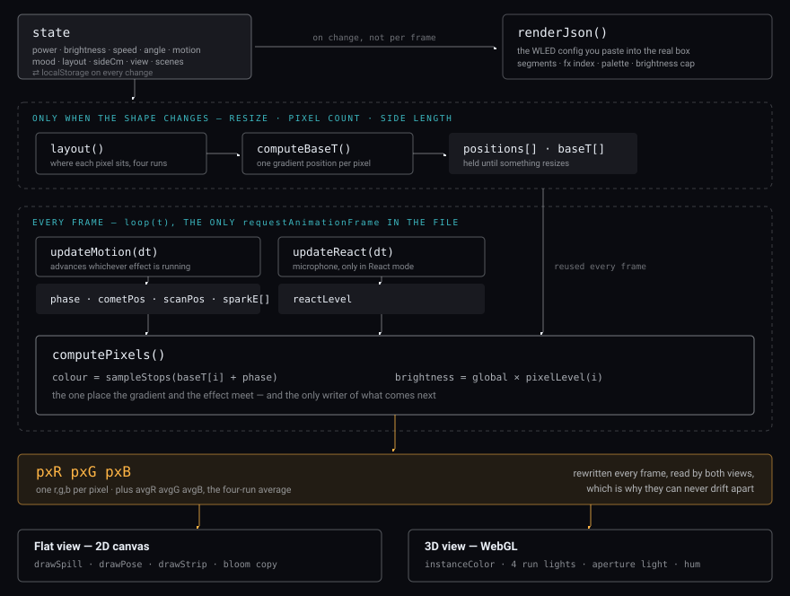
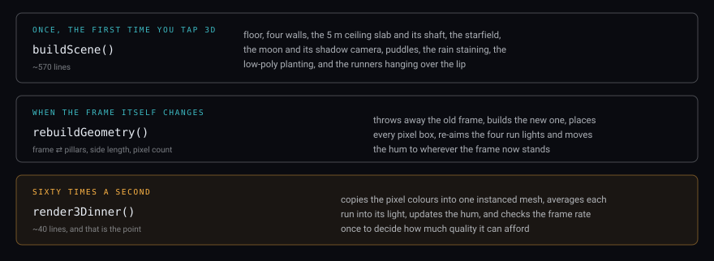

*L.I.F.E. · Phase 1*

# How the controller is put together

One **state object**. One **animation loop**. One **array of pixel colours**. Two renderers that read it and disagree about nothing. Everything else in the file is detail hanging off those four things.

- One file: 1.33 MB
- Lines: 4,093
- Six of them are: 1.13 MB
- Build step: none
- Network calls: zero

> **In this repository** the controller is no longer one file. It lives in [`controller/`](../controller/): `index.html` (markup), `style.css`, `app.js` (the program), and the six fat lines moved out — three.js to `vendor/three.min.js`, the pose artwork, wall photograph, frame module geometry, low-poly kit and poser mesh to `data/*.js` (the two images also as plain files in `assets/`). Line numbers and sizes below describe the original single-file version; the section comments still match `app.js`.

## The six fat lines

Worth knowing before you open it in an editor, because they will look like corruption. Six lines carry 85% of the file: **three.js r128** (line 877, 603 KB), the **wall photograph** (line 1874, 251 KB), the **pose artwork** (line 1265, 165 KB), the **frame module geometry** from your SketchUp export (line 1862, 58 KB), your **low-poly kit** (line 2064, 37 KB) and the **poser mesh** (line 3190, 13 KB). Nothing can be fetched at runtime, so everything the page needs has to already be in it. The remaining 4,087 lines are the actual program.

## Every frame, in order

This is the spine. If you understand this picture you can find anything else by following it outward.

The whole program in one pass. Note what is *not* in the per-frame band: the pixel positions and the gradient table are computed once and reused, which is why resizing the window is the expensive thing and running an effect is not.

> **The bit worth holding on to.** The flat view and the 3D view do not each work out what the strip is doing. They both read the same three arrays, written once per frame by `computePixels()`. Switch between the views mid-effect and the pattern does not jump, because there is only one pattern.
>
> The same arrays are what the 3D room is lit by: four lights take the average of one run each, and the aperture light takes the whole frame's average. The room gets its colour from the strip, not from a copy of the strip.

## The 3D side runs on three clocks

This is the part we have been editing — the trees, the shaft, the stains, the hum. Almost all of it happens **once**, which is why none of it costs anything per frame.

Everything expensive is in the top two bands and happens at most a handful of times. About two hundred plants and stones across the room and roof are baked into four meshes at build time for the same reason — they never move, so they never need to be thought about again.

## Where to find things

The file is signposted with section comments. Search for the string in the left column rather than a line number — the numbers move every time we touch it, the comments don't.

`// ---------- geometry ----------` — **layout()** — where each pixel sits on screen, split into the four separate runs, exactly as they are wired: each side its own strip on its own output.

`// ---------- motion state ----------` — All seven effects. **pixelLevel(i)** is the whole vocabulary — given a pixel, how bright is it right now. Adding an effect means adding a branch here.

`// ---------- the figure ----------` — The pose artwork, the alpha scan that finds its true bounding box, the light map spilling onto it, and the bottom-alignment maths.

`// ---------- react ----------` — Microphone in, one smoothed level out. Nothing else in the file knows the microphone exists.

`// ---------- main loop ----------` — Six lines. The only `requestAnimationFrame` in the program — if something animates, it is downstream of here.

`// ---------- scenes ----------` — Save and recall a look. **LOOK_KEYS** at the top defines exactly which pieces of state a scene captures — that list is the contract.

`// ---------- frame setup ----------` — Side length, LEDs per metre, COB or not, and the pixel-count arithmetic that follows from them.

`// ---------- device ----------` — The WLED JSON. **FX_INDEX** maps our effect names onto WLED's real effect numbers.

`// ---------- photo mode ----------` — Countdown, hold, and the white-ward shift that keeps a face from going green while the shutter is open.

`// ---------- 3D view ----------` — Everything WebGL, from here to the end of the file. Roughly half the program.

`// ---------- the low-poly kit ----------` — Your OBJ models: the decoder, and the batcher that bakes many copies into one mesh.

`function buildScene()` (search the name, not a comment) — The room. Walls, ceiling and shaft, sky, moon, puddles, rain staining, planting, hanging runners. If you want to change what the place looks like, it is all in here.

`// ---------- walking ----------` — First-person movement, and the collision that stops you walking through the frame.

`// ---------- the frame's own noise ----------` — The hum. Synthesised, never a recording — the sandbox cannot load an audio file.

## How it gives up quality

Three separate mechanisms, in the order they apply.

#### LITE — decided on load

True on anything with a touch screen or a short side of 820 px or less. Halves the plant counts, drops the shadow map from 3072 to 1024, softens the shadow filter. Your phone gets this; your laptop does not.

#### SAFE — your choice, remembered

Set by the "simple 3D" offer that appears when the view fails. No shadows, no reflection probe, one light instead of five. Stored under `life-safe3d-v2`, so clearing site data clears it.

#### autoQuality — measured, once

Counts real frames for 2.2 seconds after you enter 3D. Below 34 fps it gives up the reflection cube and some resolution; below 26 it gives up shadows too. Shadows go last because the shadows *are* the effect. It then stops measuring and never touches it again.

## If you want to change something

`var LEDS = 84;` — Pixel count. 84 is Build B; Build A is 540. The Frame setup pane changes it live, so you rarely need to edit this.

`var SLAB = 5.0;` — How thick the roof is. Everything downstream — the shaft walls, the treeline height, the drip staining — is derived from it.

`var MOON_DIR = …(8.2, 20.03, 6.8)` — The moon. Elevation is `atan(y / hypot(x, z))` — currently 62°, chosen as the lowest angle that still drops a beam through a centred opening onto the frame.

`var TREES = LITE ? 9 : 15;` — The treeline. Height, lean and species are all picked in the loop underneath it.

`AmbientLight(0x37465f, 0.62)` — The room's fill light. This is the number that makes the place look flat, and the reason foliage keeps needing to be hand-darkened. Turning it down is the single biggest visual change available.

`n.whine = tone(520, 0.0);` (and 300 + load\*430) — The hum's pitch — the tone itself, and how far it climbs as the strip draws more current.

`A new effect` (three places, all needed) — A branch in **pixelLevel()** so it has a shape; a button carrying `data-hud-motion` so it can be chosen; an entry in **FX_INDEX** so the exported WLED config names the right effect number on the real controller.

## What isn't there

No framework, no build step, no bundler, no dependencies to install, no server. Open the file in a browser and it runs — which is also why it has to carry three.js and every image inside itself. There is no state management library because there is one object; there is no renderer abstraction because there are two renderers and they share an array.

The one real constraint to keep in mind when adding anything: **nothing can be fetched at runtime.** No image, no model, no sound, no font beyond the one stylesheet host. If a new thing needs data, that data has to be generated in code or inlined into the file — which is why the concrete, the moon, the stars, the rain stains and the hum are all drawn or synthesised rather than loaded.

------------------------------------------------------------------------

Companion to the L.I.F.E. Build Manual and Fit-Out List. Describes the controller app as it stands after the low-poly kit, the 5 m shaft and the rain staining went in.
